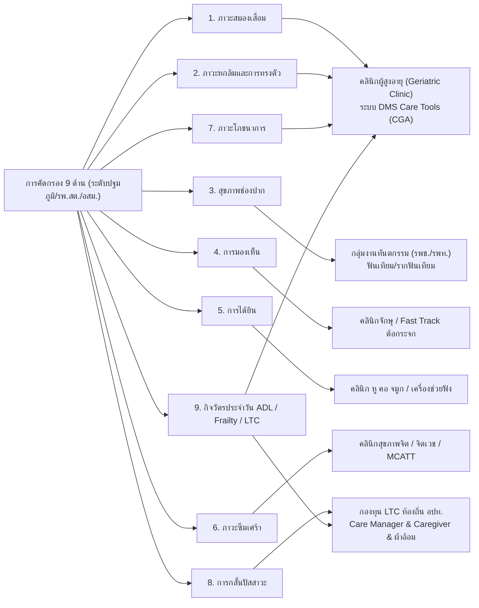

# รายงานการวิเคราะห์ประชากรผู้สูงอายุไทย ผลการคัดกรองสุขภาพ HDC และการส่งต่อประเมินในระบบ DMS Care Tools ครบ 9 ด้าน (พ.ศ. 2566 – 2569)

**หน่วยงานรวบรวมข้อมูลอ้างอิง:** กระทรวงสาธารณสุข (MOPH) และ สำนักบริหารการทะเบียน กรมการปกครอง  
**แหล่งข้อมูลหลัก:**
1. **คลังข้อมูลสุขภาพ Health Data Center (HDC) กระทรวงสาธารณสุข** ([https://hdcservice.moph.go.th](https://hdcservice.moph.go.th))
2. **ระบบ DMS Care Tools กรมการแพทย์ กระทรวงสาธารณสุข** ([https://dmscaretools.dms.go.th/geriatric/report/rep01.php](https://dmscaretools.dms.go.th/geriatric/report/rep01.php))
3. **สำนักอนามัยผู้สูงอายุ กรมอนามัย กระทรวงสาธารณสุข** (ระบบคัดกรอง Blue Book Program และ Long-Term Care: LTC)
4. **สถาบันเวชศาสตร์สมเด็จพระสังฆราชญาณสังวรเพื่อผู้สูงอายุ กรมการแพทย์** (Comprehensive Geriatric Assessment: CGA)
5. **กองยุทธศาสตร์และแผนงาน สำนักงานปลัดกระทรวงสาธารณสุข** (รายงานสถิติสาธารณสุข พ.ศ. 2566–2567)
6. **สำนักงานหลักประกันสุขภาพแห่งชาติ (สปสช.)** (กองทุนหลักประกันสุขภาพ LTC และสิทธิประโยชน์ผ้าอ้อมผู้ใหญ่/อุปกรณ์ฟื้นฟู)
7. **สถิติจำนวนประชากรทางการทะเบียน กรมการปกครอง กระทรวงมหาดไทย**

---

## 1. ข้อมูลประชากรผู้สูงอายุ (อายุ 60 ปีขึ้นไป) พ.ศ. 2566 – 2569

ประเทศไทยได้ก้าวเข้าสู่ **"สังคมสูงวัยอย่างสมบูรณ์" (Complete Aged Society)** อย่างเป็นทางการตั้งแต่ปี 2566 โดยมีสัดส่วนประชากรอายุ 60 ปีขึ้นไปเกินร้อยละ 20 ของประชากรทั้งประเทศ และกำลังขยายตัวอย่างรวดเร็วสู่ **"สังคมสูงวัยระดับสุดยอด" (Super-Aged Society)** ที่คาดว่าจะมีสัดส่วนผู้สูงอายุเกินร้อยละ 28 ภายในปี 2573–2576

### ตารางที่ 1: จำนวนและสัดส่วนร้อยละของประชากรผู้สูงอายุ 60 ปีขึ้นไป เทียบกับประชากรทั้งหมด

| ปี พ.ศ. (ปีงบประมาณ) | ประชากรทั้งหมด (คน) | ประชากรผู้สูงอายุ 60 ปีขึ้นไป (คน) | ร้อยละของผู้สูงอายุต่อประชากรทั้งหมด (%) | อัตราการเติบโตรายปี (YoY Growth Rate %) | สถานะทางประชากรศาสตร์ |
| :---: | :---: | :---: | :---: | :---: | :--- |
| **2566** | 66,052,615 | **13,064,929** | **19.78%** *(19.97% สัญชาติไทย)* | - | ก้าวสู่ Aged Society |
| **2567** | 65,950,000 | **13,745,000** | **20.84%** | **+5.21%** | Aged Society สมบูรณ์ |
| **2568** | 65,809,011 | **14,144,098** | **21.49%** | **+2.90%** | Aged Society ขยายตัวต่อเนื่อง |
| **2569** *(คาดการณ์)* | 65,680,000 | **14,650,000** | **22.31%** | **+3.58%** | เตรียมก้าวสู่ Super-Aged Society |

---

### ตารางที่ 2: โครงสร้างประชากรผู้สูงอายุจำแนกตามช่วงวัยและเพศ (ปี 2566 – 2569)

| การจำแนกกลุ่มประชากร | กลุ่มย่อย | ปี 2566 (คน) | ปี 2567 (คน) | ปี 2568 (คน) | ปี 2569 คาดการณ์ (คน) | สัดส่วนเฉลี่ย (%) |
| :--- | :--- | :---: | :---: | :---: | :---: | :---: |
| **จำแนกตามช่วงวัย** | **ผู้สูงอายุตอนต้น (60–69 ปี)** | 7,381,685 | 7,656,000 | 7,807,500 | 8,028,200 | **~55.2%** |
| | **ผู้สูงอายุตอนกลาง (70–79 ปี)** | 3,854,154 | 4,082,000 | 4,229,100 | 4,409,600 | **~29.8%** |
| | **ผู้สูงอายุตอนปลาย (80 ปีขึ้นไป)** | 1,829,090 | 2,007,000 | 2,107,498 | 2,212,200 | **~15.0%** |
| **จำแนกตามเพศ** | **เพศชาย** | 5,748,569 | 6,047,800 | 6,223,400 | 6,446,000 | **~44.0%** |
| | **เพศหญิง** | 7,316,360 | 7,697,200 | 7,920,698 | 8,204,000 | **~56.0%** |
| **รวมประชากรสูงอายุทั้งหมด** | | **13,064,929** | **13,745,000** | **14,144,098** | **14,650,000** | **100.0%** |

---

## 2. ตารางภาพรวมผลการคัดกรองสุขภาพผู้สูงอายุครบทั้ง 9 ด้าน (พ.ศ. 2566 – 2569)

ตามเกณฑ์มาตรฐานการคัดกรองและประเมินสุขภาพผู้สูงอายุของกระทรวงสาธารณสุข (คู่มือ Blue Book และระบบสารสนเทศ HDC) ผู้สูงอายุในชุมชนจะได้รับการตรวจคัดกรองสุขภาพ 9 ด้านสำคัญระดับปฐมภูมิ และส่งต่อเพื่อประเมินยืนยันด้วย Comprehensive Geriatric Assessment (CGA) ในคลินิกผู้สูงอายุ (DMS Care Tools) หรือคลินิกเฉพาะทาง:

### ตารางที่ 3: สรุปผลการคัดกรองสุขภาพผู้สูงอายุ 9 ด้านในระบบ HDC แยกตามปีงบประมาณ

*(เป้าหมายประชากร HDC Type 1 & 3: 2566 = 11.45 ล้านคน, 2567 = 11.85 ล้านคน, 2568 = 12.20 ล้านคน, 2569 = 12.60 ล้านคน; ความครอบคลุมการคัดกรองเฉลี่ย 65% – 78%)*

| ด้านที่ | ด้านการประเมิน (Domain) | เครื่องมือคัดกรองหลัก (Screening Tool) | อัตราความชุก/เสี่ยง (%) | ปี 2566 พบเสี่ยง (คน) | ปี 2567 พบเสี่ยง (คน) | ปี 2568 พบเสี่ยง (คน) | ปี 2569 คาดการณ์ (คน) |
| :---: | :--- | :--- | :---: | :---: | :---: | :---: | :---: |
| **1** | **ภาวะสมองเสื่อม** (Cognitive Impairment) | Mini-Cog / AMT (< 8 คะแนน) | **5.2% – 5.8%** | 422,500 | 467,300 | 512,400 | 570,000 |
| **2** | **ภาวะหกล้มและการทรงตัว** (Falls & Balance) | Time Up and Go Test (TUGT $\ge$ 12 วินาที) | **11.3% – 12.5%** | 913,600 | 1,007,600 | 1,099,600 | 1,220,600 |
| **3** | **สุขภาพช่องปาก** (Oral Health) | ฟันเคี้ยว < 20 ซี่ / มีรอยโรค / เคี้ยวไม่ได้ | **38.2% – 40.2%** | 2,846,200 | 3,121,500 | 3,373,300 | 3,697,600 |
| **4** | **การมองเห็นและสุขภาวะสายตา** (Visual Impairment) | Snellen / E-Chart (< 6/18) / ต้อกระจก | **24.1% – 25.4%** | 1,820,000 | 2,010,000 | 2,210,000 | 2,420,000 |
| **5** | **การได้ยิน** (Hearing Impairment) | Whisper Test / Finger Rub Test | **14.5% – 15.6%** | 1,100,000 | 1,220,000 | 1,340,000 | 1,480,000 |
| **6** | **ภาวะซึมเศร้าและสุขภาพจิต** (Depression & Mental Health) | แบบคัดกรอง 2Q $\rightarrow$ 9Q ($\ge$ 7 คะแนน) | **3.8% – 4.4%** | 305,000 | 340,000 | 375,000 | 420,000 |
| **7** | **ภาวะโภชนาการ** (Nutritional Status) | MNA-SF (< 11 คะแนน) / BMI ผิดปกติ | **6.1% – 6.8%** | 485,000 | 530,000 | 580,000 | 650,000 |
| **8** | **การกลั้นปัสสาวะ** (Urinary Incontinence) | แบบประเมินปัสสาวะเล็ด/ราด/ขัด | **4.6% – 5.4%** | 365,000 | 405,000 | 455,000 | 515,000 |
| **9** | **การปฏิบัติกิจวัตรประจำวัน ภาวะเปราะบางและ LTC** | Barthel ADL Index (ติดบ้าน/ติดเตียง) + Frailty | **2.4% พึ่งพิง** *(30.5% เปราะบาง)* | 350,000 *(พึ่งพิง LTC)* | 380,000 *(พึ่งพิง LTC)* | 410,000 *(พึ่งพิง LTC)* | 445,000 *(พึ่งพิง LTC)* |

---

## 3. รายงานเจาะลึกผลการคัดกรองและการจัดการรายด้าน ครบทั้ง 9 ด้าน

---

### ด้านที่ 1: ภาวะสมองเสื่อม (Dementia & Cognitive Impairment)
* **เครื่องมือและเกณฑ์คัดกรอง:** 
  - ปฐมภูมิ: Abbreviated Mental Test (AMT < 8 คะแนน) หรือ Mini-Cog (วาดนาฬิกาและจำคำศัพท์ 3 คำ)
  - คลินิกยืนยัน (DMS Care Tools): MMSE-Thai 2002 และ MoCA-T (Montreal Cognitive Assessment)
* **สถานการณ์ทางระบาดวิทยาและสถิติ HDC:**
  - พบความเสี่ยงเฉลี่ย **5.20% – 5.80%** ของผู้รับการคัดกรอง
  - จำนวนผู้พบความเสี่ยงในระบบ HDC: ปี 2566 = 422,500 คน, ปี 2567 = 467,300 คน, ปี 2568 = 512,400 คน, ปี 2569 คาดการณ์ = 570,000 คน
* **สถิติในระบบ DMS Care Tools กรมการแพทย์:**
  - **ปี 2566:** ประเมินยืนยัน 184,623 คน (213,254 ครั้ง) แบ่งเป็น AMT ผิดปกติ 159,849 คน, MMSE ผิดปกติ 24,774 คน, ส่งรักษาต่อเฉพาะทาง 30,978 คน (อัตราประเมินเทียบ HDC **43.70%**)
  - **ปี 2567:** ประเมินยืนยัน 170,460 คน (200,543 ครั้ง) แบ่งเป็น AMT ผิดปกติ 144,700 คน, MMSE ผิดปกติ 25,760 คน, ส่งรักษาต่อเฉพาะทาง 22,199 คน (อัตราประเมินเทียบ HDC **36.48%**)
  - **ปี 2568 (สะสม):** ประเมินยืนยัน 83,203 คน (92,333 ครั้ง) ส่งรักษาต่อ 12,887 คน
* **แนวทางการจัดการ:** ส่งต่อคลินิกความจำ (Memory Clinic) ของโรงพยาบาล ตรวจแยกสาเหตุที่รักษาหายได้ (Reversible Causes เช่น ขาดวิตามิน B12, ไทรอยด์ต่ำ) ให้ยากลุ่ม Cholinesterase Inhibitors และจัดโปรแกรมกระตุ้นการรู้คิด (Cognitive Stimulation Therapy: CST)

---

### ด้านที่ 2: ภาวะหกล้มและการทรงตัว (Falls & Balance)
* **เครื่องมือและเกณฑ์คัดกรอง:**
  - ปฐมภูมิ: ประเมินประวัติการหกล้มในรอบ 1 ปี และทดสอบการลุกเดิน Time Up and Go Test (TUGT $\ge$ 12 วินาที)
  - คลินิกยืนยัน (DMS Care Tools): 30-Second Chair Stand Test, Berg Balance Scale, และการตรวจระบบประสาท/สายตา/ยาที่ส่งผลต่อการทรงตัว
* **สถานการณ์ทางระบาดวิทยาและสถิติ HDC:**
  - พบความเสี่ยงเฉลี่ย **11.30% – 12.50%**
  - จำนวนผู้พบความเสี่ยงในระบบ HDC: ปี 2566 = 913,600 คน, ปี 2567 = 1,007,600 คน, ปี 2568 = 1,099,600 คน, ปี 2569 คาดการณ์ = 1,220,600 คน
* **สถิติในระบบ DMS Care Tools กรมการแพทย์:**
  - **ปี 2566:** ประเมินในคลินิก 421,087 คน (533,641 ครั้ง) ส่งรักษาต่อ 46,943 คน, จัดทำ Care Plan 11,169 คน (อัตราประเมินเทียบ HDC **46.09%**)
  - **ปี 2567:** ประเมินในคลินิก 391,596 คน (496,658 ครั้ง) ส่งรักษาต่อ 41,599 คน, จัดทำ Care Plan 9,818 คน (อัตราประเมินเทียบ HDC **38.86%**)
  - **ปี 2568 (สะสม):** ประเมินในคลินิก 209,938 คน (254,567 ครั้ง) ส่งรักษาต่อ 23,176 คน
* **แนวทางการจัดการ:** กายภาพบำบัดฝึกการทรงตัวและเพิ่มกำลังกล้ามเนื้อขา ปรับเปลี่ยนยาที่มีฤทธิ์กดประสาทหรือทำให้ความดันโลหิตตกท่ายืน แนะนำอุปกรณ์ช่วยเดิน (Walking aids) และประสาน อปท. ปรับสภาพแวดล้อมในบ้าน (ติดราวจับ, ปรับพื้นกันลื่น)

---

### ด้านที่ 3: สุขภาพช่องปาก (Oral Health)
* **เครื่องมือและเกณฑ์คัดกรอง:**
  - การตรวจนับจำนวนฟันแท้ที่ใช้งานเคี้ยวอาหารได้ ($\ge$ 20 ซี่ และมีฟันกรามสบกัน $\ge$ 4 คู่)
  - ตรวจหาฟันผุ, โรคปริทันต์อักเสบ, แผลเรื้อรังหรือรอยโรคก่อนมะเร็งในช่องปาก
* **สถานการณ์ทางระบาดวิทยาและสถิติ HDC:**
  - เป็นด้านที่ตรวจพบความผิดปกติสูงที่สุดถึง **38.20% – 40.20%**
  - จำนวนผู้พบความเสี่ยงในระบบ HDC: ปี 2566 = 2,846,200 คน, ปี 2567 = 3,121,500 คน, ปี 2568 = 3,373,300 คน, ปี 2569 คาดการณ์ = 3,697,600 คน
* **สถิติในระบบ DMS Care Tools vs ระบบทันตกรรม:**
  - ผู้สูงอายุที่บันทึกใน DMS Care Tools: ปี 2566 = 20,963 คน, ปี 2567 = 21,268 คน, ปี 2568 (สะสม) = 10,092 คน คิดเป็นสัดส่วนเพียง **0.68% – 0.74%** ของผู้มีความเสี่ยงใน HDC
  - **เหตุผลเชิงระบบ:** ผู้สูงอายุร้อยละ 99 ที่มีปัญหาช่องปากจะถูกส่งต่อตรงเข้า **"กลุ่มงานทันตกรรมของโรงพยาบาล"** โดยบันทึกผ่านระบบ HIS เข้าสู่แฟ้มข้อมูล `dental` ของ HDC โดยตรง เพื่อเข้าสู่โครงการฟันเทียมพระราชทานและการใส่รากฟันเทียมตามสิทธิบัตรทอง สปสช.
* **แนวทางการจัดการ:** บูรณาการทันตสาธารณสุข คลินิกฟันเทียม จัดทำฟันปลอมถอดได้ ป้องกันภาวะสำลัก และฟื้นฟูประสิทธิภาพการบดเคี้ยวอาหารเพื่อป้องกันทุโภชนาการ

---

### ด้านที่ 4: การมองเห็นและสุขภาวะสายตา (Visual Impairment & Cataract)
* **เครื่องมือและเกณฑ์คัดกรอง:**
  - ปฐมภูมิ: ตรวจวัดระดับการมองเห็นด้วย Snellen Chart หรือ Tumbling E Chart ที่ระยะ 6 เมตร (ผิดปกติเมื่อสายตาแย่กว่า 6/18) และตรวจรูม่านตาด้วยไฟฉาย (Torch light examination)
  - คลินิกเฉพาะทาง: ตรวจ Slit-lamp biomicroscopy, วัดความดันลูกตา (Tonometry), ตรวจจอประสาทตา (Funduscopy)
* **สถานการณ์ทางระบาดวิทยาและสถิติ HDC:**
  - พบอัตราความผิดปกติเฉลี่ย **24.10% – 25.40%** (สูงเป็นอันดับ 2 ของการคัดกรองทั้งหมด)
  - จำนวนผู้พบความผิดปกติใน HDC: ปี 2566 = 1,820,000 คน, ปี 2567 = 2,010,000 คน, ปี 2568 = 2,210,000 คน, ปี 2569 คาดการณ์ = 2,420,000 คน
  - สาเหตุสำคัญ: **โรคต้อกระจกในวัยชรา (Senile Cataract)** พบมากกว่า 70% ของปัญหาตา รองลงมาคือโรคต้อหิน (Glaucoma) จอประสาทตาเสื่อม (AMD) และเบาหวานขึ้นจอตา (Diabetic Retinopathy)
* **แนวทางการจัดการ:**
  - ส่งต่อคลินิกจักษุแพทย์เพื่อผ่าตัดเปลี่ยนเลนส์แก้วตาเทียม (Cataract Surgery with IOL) ผ่านระบบ Fast Track สปสช. (สถิติบริการผู้ป่วยใน IPD สปสช. สูงเป็นอันดับ 3 กว่า 200,487 ครั้ง/ปี)
  - สนับสนุนแว่นสายตาสำหรับผู้สูงอายุที่มีสายตายาวหรือสายตาผิดปกติผ่านกองทุนสุขภาพตำบล

---

### ด้านที่ 5: การได้ยิน (Hearing Impairment)
* **เครื่องมือและเกณฑ์คัดกรอง:**
  - ปฐมภูมิ: การทดสอบเสียงกระซิบ (Whisper Test) ที่ระยะ 2 ฟุต (60 ซม.) นอกลานสายตา หรือ Finger Rub Test (ใช้นิ้วชี้และหัวแม่มือถูกันข้างหู)
  - คลินิกยืนยัน: การตรวจเครื่องส่องหู (Otoscopy) ตรวจขี้หูอุดตัน และตรวจสมรรถภาพการได้ยินด้วยเครื่องตรวจการได้ยิน (Pure Tone Audiometry) ในห้องเก็บเสียง
* **สถานการณ์ทางระบาดวิทยาและสถิติ HDC:**
  - พบอัตราความผิดปกติเฉลี่ย **14.50% – 15.60%**
  - จำนวนผู้พบความผิดปกติใน HDC: ปี 2566 = 1,100,000 คน, ปี 2567 = 1,220,000 คน, ปี 2568 = 1,340,000 คน, ปี 2569 คาดการณ์ = 1,480,000 คน
* **ผลกระทบทางคลินิกและสังคม:** ภาวะหูตึงในผู้สูงอายุ (Presbycusis) สัมพันธ์โดยตรงกับการเกิด **ภาวะถดถอยของการรู้คิด สมองเสื่อม และภาวะแยกตัวจากสังคม (Social Isolation)**
* **แนวทางการจัดการ:**
  - ส่งต่อแผนก โสต ศอ นาสิก (ENT Clinic) ทำการตรวจวินิจฉัยแยกรอยโรคที่แก้ไขได้ (เช่น ขี้หูอุดตัน, เยื่อแก้วหูทะลุ)
  - ส่งตรวจประเมินความพิการทางการได้ยินเพื่อขอรับสิทธิการใส่ **"เครื่องช่วยฟังดิจิทัล" (Digital Hearing Aid)** ภายใต้ชุดสิทธิประโยชน์บัตรทอง สปสช.

---

### ด้านที่ 6: ภาวะซึมเศร้าและสุขภาพจิต (Depression & Mental Health)
* **เครื่องมือและเกณฑ์คัดกรอง:**
  - ปฐมภูมิ ขั้นที่ 1: แบบคัดกรอง 2 คำถาม (2Q) ได้แก่ รู้สึกหดหู่ เศร้า ท้อแท้ หรือ รู้สึกเบื่อ ไม่เพลิดเพลิน
  - ปฐมภูมิ ขั้นที่ 2: หากตอบ "มี" ใน 2Q ข้อใดข้อหนึ่ง ให้ทำแบบประเมินโรคซึมเศร้า 9 คำถาม (9Q) โดยคะแนน $\ge$ 7 บ่งชี้ว่ามีภาวะซึมเศร้า
  - การประเมินความเสี่ยงเร่งด่วน: ประเมินความเสี่ยงต่อการฆ่าตัวตาย (8Q)
* **สถานการณ์ทางระบาดวิทยาและสถิติ HDC:**
  - พบอัตราความเสี่ยงเฉลี่ย **3.80% – 4.40%**
  - จำนวนผู้พบความเสี่ยงใน HDC: ปี 2566 = 305,000 คน, ปี 2567 = 340,000 คน, ปี 2568 = 375,000 คน, ปี 2569 คาดการณ์ = 420,000 คน
  - สถิติระบาดวิทยาชี้ว่า ผู้สูงอายุชายมีอัตราการฆ่าตัวตายสำเร็จสูงที่สุดเมื่อเทียบกับทุกกลุ่มวัยเนื่องจากใช้วิธีการที่รุนแรง
* **แนวทางการจัดการ:**
  - ระดับคะแนน 9Q เล็กน้อย (7–12): ให้คำปรึกษาประคับประคองจิตใจ (Counseling) กิจกรรมบำบัด ชวนเข้าร่วมชมรมผู้สูงอายุ
  - ระดับคะแนน 9Q ปานกลางถึงรุนแรง ($\ge$ 13) หรือ 8Q มีความเสี่ยง: ส่งต่อแพทย์/จิตแพทย์ และทีม MCATT ให้การบำบัดรักษาด้วยยาต้านเศร้า (เช่น SSRIs ที่ปลอดภัยต่อผู้สูงอายุ เช่น Sertraline) และติดตามเยี่ยมบ้านต่อเนื่อง

---

### ด้านที่ 7: ภาวะโภชนาการ (Nutritional Status & Malnutrition)
* **เครื่องมือและเกณฑ์คัดกรอง:**
  - ปฐมภูมิ: Mini Nutritional Assessment - Short Form (MNA-SF) ประเมินความอยากอาหาร การลดลงของน้ำหนักใน 3 เดือน การเคลื่อนไหว ความเครียดทางจิตใจ และดัชนีมวลกาย (BMI)
  - เกณฑ์แปลผล: 12–14 คะแนน = ภาวะโภชนาการปกติ, 8–11 คะแนน = มีความเสี่ยงต่อภาวะทุโภชนาการ, 0–7 คะแนน = ขาดสารอาหาร
* **สถานการณ์ทางระบาดวิทยาและสถิติ HDC:**
  - พบความเสี่ยงเฉลี่ย **6.10% – 6.80%**
  - จำนวนผู้พบความเสี่ยงใน HDC: ปี 2566 = 485,000 คน, ปี 2567 = 530,000 คน, ปี 2568 = 580,000 คน, ปี 2569 คาดการณ์ = 650,000 คน
  - ปัญหาสำคัญร่วม: **ภาวะมวลกล้ามเนื้อน้อย (Sarcopenia)** ตรวจพบสูงถึง **30.5%** ของผู้สูงอายุไทย มวลกล้ามเนื้อลดลง 1–2% ต่อปีหลังอายุ 50 ปี ส่งผลให้แรงบีบมือลดลง ทรงตัวไม่อยู่
* **แนวทางการจัดการ:**
  - ให้คำปรึกษาโภชนบำบัดผู้สูงอายุ สนับสนุนอาหารเสริมโปรตีนสูงและวิตามิน D/แคลเซียม
  - ประสานการรักษาด้านทันตกรรมเพื่อแก้ไขปัญหาเคี้ยวไม่ได้ และฝึกกายบริหารเพิ่มมวลกล้ามเนื้อ (Resistance Training)

---

### ด้านที่ 8: การกลั้นปัสสาวะ (Urinary Incontinence)
* **เครื่องมือและเกณฑ์คัดกรอง:**
  - แบบประเมินอาการขับถ่ายปัสสาวะ (Urinary Incontinence Screening Questionnaire) ซักประวัติอาการปัสสาวะเล็ดขณะไอ จาม หรือยกของหนัก (Stress Incontinence), ปัสสาวะราดเมื่อรู้สึกปวดกลั้นไม่ทัน (Urge Incontinence), ปัสสาวะขัดหยดตลอดเวลา (Overflow Incontinence)
* **สถานการณ์ทางระบาดวิทยาและสถิติ HDC:**
  - พบอัตราความผิดปกติเฉลี่ย **4.60% – 5.40%**
  - จำนวนผู้พบความผิดปกติใน HDC: ปี 2566 = 365,000 คน, ปี 2567 = 405,000 คน, ปี 2568 = 455,000 คน, ปี 2569 คาดการณ์ = 515,000 คน
  - เพศหญิงมักเกิดจากกล้ามเนื้ออุ้งเชิงกรานหย่อนจากการคลอดบุตรและขาดฮอร์โมนเอสโตรเจน เพศชายมักเกิดจากต่อมลูกหมากโต (BPH)
* **แนวทางการจัดการ:**
  - ฝึกบริหารกล้ามเนื้ออุ้งเชิงกราน (Kegel Exercise) และปรับพฤติกรรมการดื่มน้ำ
  - การรักษาทางการแพทย์: ยาลดการบีบตัวของกระเพาะปัสสาวะ, ผ่าตัดต่อมลูกหมากโตในผู้ชาย
  - **การสนับสนุนเชิงนโยบาย สปสช.:** การสนับสนุน **"ผ้าอ้อมผู้ใหญ่และแผ่นรองซับการขับถ่าย"** ฟรีวันละไม่เกิน 3 ชิ้น สำหรับผู้สูงอายุที่มีปัญหาการขับถ่ายหรือติดบ้านติดเตียง เพื่อป้องกันแผลกดทับและการติดเชื้อทางเดินปัสสาวะ

---

### ด้านที่ 9: การปฏิบัติกิจวัตรประจำวัน (ADL), ภาวะเปราะบาง (Frailty) และระบบ LTC
* **เครื่องมือและเกณฑ์คัดกรอง:**
  - **Barthel Activities of Daily Living (Barthel ADL Index):** ประเมินความสามารถ 10 กิจกรรม (กินอาหาร, ล้างหน้า, แปรงฟัน, อาบน้ำ, สวมใส่เสื้อผ้า, เคลื่อนย้ายตัว, เดิน, ขึ้นลงบันได, การกลั้นอุจจาระ, การกลั้นปัสสาวะ)
  - **ภาวะเปราะบาง (Frailty):** ประเมินด้วย Clinical Frailty Scale (CFS) หรือ Fried Frailty Criteria (น้ำหนักลด, อ่อนเพลีย, แรงบีบมือต่ำ, เดินช้า, กิจกรรมทางกายต่ำ)

#### ก. การจำแนกกลุ่มตามเกณฑ์ Barthel ADL
* **กลุ่มติดสังคม (Social-Bound, ADL 12–20 คะแนน):** ประมาณ **97.6%** (~14.1 – 14.4 ล้านคน) ช่วยเหลือตนเองได้ดี ไม่มีภาวะพึ่งพิง
* **กลุ่มติดบ้าน (Home-Bound, ADL 5–11 คะแนน):** ประมาณ **1.3%** (~185,000 – 195,000 คน) ช่วยเหลือตนเองได้บางส่วน ต้องการคนช่วยเหลือพยุง
* **กลุ่มติดเตียง (Bed-Bound, ADL 0–4 คะแนน):** ประมาณ **1.1%** (~155,000 – 165,000 คน) ช่วยเหลือตนเองไม่ได้ ภาวะพึ่งพิงสมบูรณ์
* **รวมผู้สูงอายุที่มีภาวะพึ่งพิง (ติดบ้าน + ติดเตียง):** ประมาณ **2.4%** หรือคิดเป็นจำนวนสะสมกว่า **350,000 – 445,000 คน** ทั่วประเทศ

#### ข. การจัดกลุ่มการดูแลระยะยาว 4 กลุ่ม (ตามเกณฑ์ สธ. / สปสช. LTC)

| กลุ่ม LTC | เกณฑ์ทางคลินิกและพฤติกรรม | สัดส่วนในกลุ่มพึ่งพิง | แผนการดูแลและความถี่ | ชุดสิทธิประโยชน์ที่ได้รับ |
| :---: | :--- | :---: | :--- | :--- |
| **กลุ่มที่ 1** | เคลื่อนไหวได้บ้าง มีปัญหาการกินหรือขับถ่าย **ไม่มี** ภาวะสับสน (ADL 5–11) | **42.5%** | CG เยี่ยม 1–2 ครั้ง/สัปดาห์ | กายภาพบำบัดพื้นฐาน, แนะนำโภชนาการ, ยา |
| **กลุ่มที่ 2** | เคลื่อนไหวได้บ้าง มีปัญหาการกินหรือขับถ่าย **มี** ภาวะสับสน/สมองเสื่อม (ADL 5–11) | **24.1%** | CG เยี่ยม 2–3 ครั้ง/สัปดาห์ | กระตุ้นการรู้คิด, ป้องกันการพลัดหลง, ปรับพฤติกรรม |
| **กลุ่มที่ 3** | **กลุ่มติดเตียง** (ADL 0–4) ช่วยเหลือตนเองไม่ได้ แต่อาการคงที่ ไม่ป่วยรุนแรง | **21.8%** | CG เยี่ยม 3–5 ครั้ง/สัปดาห์ | พลิกตัวป้องกันแผลกดทับ, ดูแลความสะอาดสายสวน |
| **กลุ่มที่ 4** | **กลุ่มติดเตียง** (ADL 0–4) **และมีอาการป่วยรุนแรง หรือระยะท้าย (Palliative)** | **11.6%** | CM และ CG เยี่ยมทุกวัน | การดูแลแบบประคับประคอง, จัดการความปวด |

#### ค. กลไกการขับเคลื่อนระบบ LTC และงบประมาณ
* **Care Manager (CM):** พยาบาลวิชาชีพ/นักวิชาการสาธารณสุข ประเมินและจัดทำ **Care Plan** รายบุคคล
* **Caregiver (CG):** ผู้ช่วยเหลือดูแลผู้สูงอายุในชุมชน (อัตราส่วน 1 คน ดูแลผู้สูงอายุ 4–6 คน)
* **กองทุน LTC ระดับท้องถิ่น (อปท.):** ในปี 2567 สปสช. ได้อนุมัติปรับเพิ่มงบประมาณสนับสนุนจากเดิม 6,000 บาท เป็น **10,442 บาท/คน/ปี** เพื่อครอบคลุมค่าบริการและชุดอุปกรณ์ดูแลระยะยาว
* **ระบบ Intermediate Care (IMC):** ฟื้นฟูผู้ป่วยหลังพ้นวิกฤต เช่น สโตรก และกระดูกสะโพกหัก ภายใน 6 เดือนทอง (Golden Period) เพื่อลดการตกเป็นผู้ป่วยติดบ้านติดเตียงถาวร

---

## 4. การวิเคราะห์เปรียบเทียบสัดส่วน: HDC กับการส่งต่อประเมิน (Cascade of Care)

### ตารางที่ 4: การเปรียบเทียบสัดส่วนผู้มีความเสี่ยงใน HDC กับการประเมินใน DMS Care Tools / ระบบเฉพาะทาง

| ด้านสุขภาพ | ปี พ.ศ. | ผู้มีความเสี่ยงใน HDC (คน) | ประเมินใน DMS Care Tools (คน) | สัดส่วนที่ประเมินใน DMS (%) | ช่องทางบริการหลักที่รองรับผู้ป่วยส่วนใหญ่ |
| :--- | :---: | :---: | :---: | :---: | :--- |
| **1. สมองเสื่อม** | 2566 | 422,500 | 184,623 | **43.70%** | คลินิกผู้สูงอายุ (Geriatric Clinic) / Memory Clinic |
| | 2567 | 467,300 | 170,460 | **36.48%** | คลินิกผู้สูงอายุ / Memory Clinic |
| | 2568 | 512,400 | 83,203 *(สะสม)* | **16.24%** | คลินิกผู้สูงอายุ / Memory Clinic |
| | 2569 | 570,000 | 0 *(เป้าหมาย ~216,000)* | **~38.00%** *(เป้าหมาย)* | ขยายคลินิกความจำครอบคลุม รพช. |
| **2. หกล้ม** | 2566 | 913,600 | 421,087 | **46.09%** | คลินิกผู้สูงอายุ / งานกายภาพบำบัด |
| | 2567 | 1,007,600 | 391,596 | **38.86%** | คลินิกผู้สูงอายุ / งานกายภาพบำบัด |
| | 2568 | 1,099,600 | 209,938 *(สะสม)* | **19.09%** | คลินิกผู้สูงอายุ / งานกายภาพบำบัด |
| | 2569 | 1,220,600 | 0 *(เป้าหมาย ~470,000)* | **~38.50%** *(เป้าหมาย)* | คลินิกป้องกันหกล้ม (Falls Clinic) |
| **3. สุขภาพช่องปาก** | 2566 | 2,846,200 | 20,963 | **0.74%** | กลุ่มงานทันตกรรม รพ. (>99% ผ่านแฟ้ม dental HDC) |
| | 2567 | 3,121,500 | 21,268 | **0.68%** | กลุ่มงานทันตกรรม รพ. (>99% ผ่านแฟ้ม dental HDC) |
| | 2568 | 3,373,300 | 10,092 *(สะสม)* | **0.30%** | กลุ่มงานทันตกรรม รพ. (>99% ผ่านแฟ้ม dental HDC) |
| | 2569 | 3,697,600 | 0 *(เป้าหมาย ~24,000)* | **~0.65%** *(เป้าหมาย)* | โครงการฟันเทียมพระราชทาน / รากฟันเทียม |
| **4. การมองเห็น** | 2566–2568 | ~2.01 ล้าน/ปี | บันทึกแยกแผนก | *ส่งต่อเฉพาะทาง* | คลินิกจักษุแพทย์ / ผ่าตัดต้อกระจก สปสช. (>2 แสนครั้ง/ปี) |
| **5. การได้ยิน** | 2566–2568 | ~1.22 ล้าน/ปี | บันทึกแยกแผนก | *ส่งต่อเฉพาะทาง* | แผนก ENT / ตรวจ Audiogram / เครื่องช่วยฟัง สปสช. |
| **6. ซึมเศร้า** | 2566–2568 | ~3.4 แสน/ปี | บันทึกแยกแผนก | *ส่งต่อเฉพาะทาง* | คลินิกสุขภาพจิตและจิตเวช / ระบบสารสนเทศ รง.506 |
| **7. โภชนาการ** | 2566–2568 | ~5.3 แสน/ปี | ส่วนหนึ่งใน CGA | *บูรณาการในคลินิก* | โภชนาการคลินิก / เสริมโปรตีน / ฟื้นฟู Sarcopenia |
| **8. การกลั้นปัสสาวะ** | 2566–2568 | ~4.0 แสน/ปี | ส่วนหนึ่งใน CGA | *บูรณาการในคลินิก* | คลินิกทางเดินปัสสาวะ / แจกผ้าอ้อมผู้ใหญ่ สปสช. |
| **9. ADL & LTC** | 2566–2568 | ~3.8 แสน/ปี | ประเมิน Barthel | **ขึ้นทะเบียน LTC** | กองทุน LTC อปท. / Care Plan โดย CM และ CG |

---

## 5. บทวิเคราะห์เชิงระบบบริการสุขภาพ (Health Systems Insights & Policy Recommendations)

จากการวิเคราะห์ข้อมูลผลการคัดกรอง 9 ด้านและการส่งต่อบริการสุขภาพในระดับประเทศ พบประเด็นเชิงโครงสร้าง 4 ประการ:

### 1. ความเหลื่อมล้ำในการเชื่อมต่อระหว่างระบบปฐมภูมิ (HDC) และทุติยภูมิ/ตติยภูมิ
* **สมองเสื่อมและหกล้ม** เป็น 2 ด้านหลักที่มีอัตราการเข้าสู่คลินิกผู้สูงอายุ (DMS Care Tools) สูงที่สุด (36% – 46%) สะท้อนความสำเร็จของนโยบาย Service Plan สาขาผู้สูงอายุที่ผลักดันให้โรงพยาบาลระดับ A, S, M มีคลินิกผู้สูงอายุคุณภาพ
* อย่างไรก็ตาม ด้านอื่นๆ เช่น **ช่องปาก, สายตา, การได้ยิน และสุขภาพจิต** มี "ทางด่วนบริการเฉพาะทาง" (Vertical Programs) แยกขาดจากคลินิกผู้สูงอายุ ทำให้ข้อมูลกระจัดกระจายอยู่ในระบบสารสนเทศเฉพาะแผนก ไม่ได้สะท้อนรวมในระบบ DMS Care Tools

### 2. ปัญหาสุขภาพช่องปากและการมองเห็นเป็นภาระโรคสูงสุด
* ปัญหาช่องปาก (38–40%) และปัญหาการมองเห็น (24–25%) เป็น 2 ปัญหาที่ตรวจพบสูงสุดในชุมชน ส่งผลกระทบต่อเนื่องโดยตรงต่อภาวะโภชนาการ การเกิดภาวะมวลกล้ามเนื้อน้อย (Sarcopenia) และเพิ่มความเสี่ยงต่อการพลัดตกหกล้ม 2–3 เท่า การบูรณาการตรวจช่องปากและสายตาร่วมกับการประเมินภาวะหกล้มจึงเป็นจุดคานงัดสำคัญ

### 3. ระบบการดูแลระยะยาว (LTC) และภาวะพึ่งพิง 2.4% ที่ขยายตัวต่อเนื่อง
* ผู้สูงอายุที่มีภาวะพึ่งพิง (ติดบ้านและติดเตียง) แม้คิดเป็นสัดส่วนเพียงร้อยละ 2.4 แต่มีจำนวนสูงถึง 3.5 – 4.4 แสนคน การเพิ่มงบประมาณกองทุน LTC เป็น 10,442 บาท/คน/ปี พร้อมการแจกผ้าอ้อมผู้ใหญ่ช่วยแบ่งเบาภาระครอบครัวได้อย่างมาก แต่ยังเผชิญความท้าทายจาก **"ครัวเรือนแหว่งกลาง" (8.2%)** และผู้สูงอายุที่อาศัยอยู่คนเดียวตามลำพัง (12.0%) ซึ่งขาดแคลนผู้ดูแลในครอบครัว

### 4. ข้อเสนอแนะเชิงนโยบายเพื่อการขับเคลื่อนสู่ปี 2569
1. **Single Elderly Data Platform:** พัฒนาระบบเชื่อมโยงข้อมูลแบบ API ไร้รอยต่อระหว่าง HDC (ระดับชุมชน), Blue Book (กรมอนามัย), DMS Care Tools (กรมการแพทย์) และ E-Claim/LTC (สปสช.) เพื่อลดภาระการคีย์ข้อมูลซ้ำซ้อนของบุคลากร
2. **ขยาย CGA สู่ระดับ รพ.ชุมชน (F1-F3):** สนับสนุนให้แพทย์เวชศาสตร์ครอบครัวและพยาบาลผู้จัดการการดูแลสามารถใช้เครื่องมือ Comprehensive Geriatric Assessment แบบย่อ เพื่อให้การคัดกรอง 9 ด้านได้รับการวินิจฉัยและดูแลแบบองค์รวมในระดับอำเภอ
3. **บูรณาการเชิงรุกในการป้องกันภาวะเปราะบาง (Pre-Frailty Intervention):** มุ่งเน้นการตรวจคัดกรองมวลกล้ามเนื้อ โภชนาการ และการออกกำลังกายในกลุ่มผู้สูงอายุตอนต้น (60–69 ปี) เพื่อชะลอการเปลี่ยนผ่านจากกลุ่มติดสังคมไปสู่กลุ่มติดบ้านและติดเตียง
