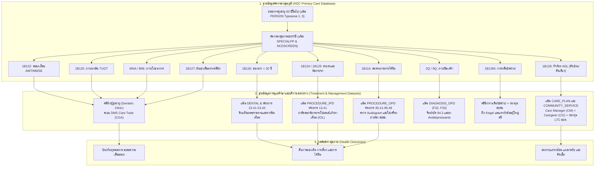

# รายงานการวิเคราะห์ประชากรผู้สูงอายุไทย ผลการคัดกรองสุขภาพ HDC รหัสข้อมูล 43 แฟ้ม และสถิติผู้ได้รับการดูแลรักษาในระบบ DMS Care Tools และสถานพยาบาล (พ.ศ. 2566 – 2569)

**หน่วยงานรวบรวมข้อมูลอ้างอิง:** กระทรวงสาธารณสุข (MOPH) และ สำนักบริหารการทะเบียน กรมการปกครอง  
**แหล่งข้อมูลหลัก:**
1. **คลังข้อมูลสุขภาพ Health Data Center (HDC) กระทรวงสาธารณสุข** ([https://hdcservice.moph.go.th](https://hdcservice.moph.go.th))
2. **ระบบ DMS Care Tools กรมการแพทย์ กระทรวงสาธารณสุข** ([https://dmscaretools.dms.go.th/geriatric/report/rep01.php](https://dmscaretools.dms.go.th/geriatric/report/rep01.php))
3. **สำนักอนามัยผู้สูงอายุ กรมอนามัย กระทรวงสาธารณสุข** (ระบบคัดกรอง Blue Book Program และ Long-Term Care: LTC)
4. **สถาบันเวชศาสตร์สมเด็จพระสังฆราชญาณสังวรเพื่อผู้สูงอายุ กรมการแพทย์** (Comprehensive Geriatric Assessment: CGA)
5. **กองยุทธศาสตร์และแผนงาน สำนักงานปลัดกระทรวงสาธารณสุข** (รายงานสถิติสาธารณสุข พ.ศ. 2566–2567 และโครงสร้างมาตรฐานข้อมูล 43 แฟ้ม)
6. **สำนักงานหลักประกันสุขภาพแห่งชาติ (สปสช.)** (กองทุน LTC อปท., ข้อมูลบริการผู้ป่วยใน IPD/OPD, สิทธิประโยชน์ฟันเทียม/ผ่าตัดต้อกระจก/ผ้าอ้อมผู้ใหญ่)
7. **สถิติจำนวนประชากรทางการทะเบียน กรมการปกครอง กระทรวงมหาดไทย**

---

## 1. ข้อมูลประชากรผู้สูงอายุ (อายุ 60 ปีขึ้นไป) พ.ศ. 2566 – 2569

ประเทศไทยได้ก้าวเข้าสู่ **"สังคมสูงวัยอย่างสมบูรณ์" (Complete Aged Society)** อย่างเป็นทางการตั้งแต่ปี 2566 โดยมีสัดส่วนประชากรอายุ 60 ปีขึ้นไปเกินร้อยละ 20 ของประชากรทั้งประเทศ และกำลังขยายตัวอย่างต่อเนื่องสู่ **"สังคมสูงวัยระดับสุดยอด" (Super-Aged Society)** ที่คาดว่าจะมีสัดส่วนผู้สูงอายุเกินร้อยละ 28 ภายในปี 2573–2576

### ตารางที่ 1: จำนวนและสัดส่วนร้อยละของประชากรผู้สูงอายุ 60 ปีขึ้นไป เทียบกับประชากรทั้งหมด

| ปี พ.ศ. (ปีงบประมาณ) | ประชากรทั้งหมด (คน) | ประชากรผู้สูงอายุ 60 ปีขึ้นไป (คน) | ร้อยละของผู้สูงอายุต่อประชากรทั้งหมด (%) | อัตราการเติบโตรายปี (YoY Growth Rate %) | สถานะทางประชากรศาสตร์ |
| :---: | :---: | :---: | :---: | :---: | :--- |
| **2566** | 66,052,615 | **13,064,929** | **19.78%** *(19.97% สัญชาติไทย)* | - | ก้าวสู่ Aged Society |
| **2567** | 65,950,000 | **13,745,000** | **20.84%** | **+5.21%** | Aged Society สมบูรณ์ |
| **2568** | 65,809,011 | **14,144,098** | **21.49%** | **+2.90%** | Aged Society ขยายตัวต่อเนื่อง |
| **2569** *(คาดการณ์)* | 65,680,000 | **14,650,000** | **22.31%** | **+3.58%** | เตรียมก้าวสู่ Super-Aged Society |

---

### ตารางที่ 2: โครงสร้างประชากรผู้สูงอายุจำแนกตามช่วงวัยและเพศ (ปี 2566 – 2569)

| การจำแนกกลุ่มประชากร | กลุ่มย่อย | ปี 2566 (คน) | ปี 2567 (คน) | ปี 2568 (คน) | ปี 2569 คาดการณ์ (คน) | สัดส่วนเฉลี่ย (%) |
| :--- | :--- | :---: | :---: | :---: | :---: | :---: |
| **จำแนกตามช่วงวัย** | **ผู้สูงอายุตอนต้น (60–69 ปี)** | 7,381,685 | 7,656,000 | 7,807,500 | 8,028,200 | **~55.2%** |
| | **ผู้สูงอายุตอนกลาง (70–79 ปี)** | 3,854,154 | 4,082,000 | 4,229,100 | 4,409,600 | **~29.8%** |
| | **ผู้สูงอายุตอนปลาย (80 ปีขึ้นไป)** | 1,829,090 | 2,007,000 | 2,107,498 | 2,212,200 | **~15.0%** |
| **จำแนกตามเพศ** | **เพศชาย** | 5,748,569 | 6,047,800 | 6,223,400 | 6,446,000 | **~44.0%** |
| | **เพศหญิง** | 7,316,360 | 7,697,200 | 7,920,698 | 8,204,000 | **~56.0%** |
| **รวมประชากรสูงอายุทั้งหมด** | | **13,064,929** | **13,745,000** | **14,144,098** | **14,650,000** | **100.0%** |

---

## 2. สถาปัตยกรรมข้อมูล HDC และพจนานุกรมรหัสมาตรฐาน (HDC 43 Folders & Coding System)

ในการประมวลผลตัวชี้วัดสุขภาพผู้สูงอายุของระบบคลังข้อมูลสุขภาพ HDC กระทรวงสาธารณสุข ข้อมูลไม่ได้จำกัดอยู่เพียงแบบฟอร์มคัดกรองทั่วไป แต่ถูกดึงและเชื่อมโยงจากฐานข้อมูลมาตรฐาน **43 แฟ้มสาธารณสุข** ผ่านรหัสบริการ รหัสโรค และรหัสหัตถการ ดังนี้:

### 2.1 แฟ้มข้อมูลหลักในระบบ 43 แฟ้มที่ HDC ดึงมาประมวลผล
1. **แฟ้ม `PERSON`:** ใช้กำหนดกลุ่มประชากรเป้าหมาย โดยกำหนดเงื่อนไข:
   - มีอายุ 60 ปีบริบูรณ์ขึ้นไป (`AGE >= 60`)
   - สถานะการอยู่อาศัยในเขตรับผิดชอบ (`TYPEAREA IN ('1', '3')` คือ มีชื่อและตัวอยู่จริง หรือ ตัวอยู่จริงแต่ไม่มีชื่อในทะเบียนบ้าน)
2. **แฟ้ม `SPECIALPP` (บริการสร้างเสริมสุขภาพและป้องกันโรคเฉพาะ):** ใช้เก็บข้อมูลผลการคัดกรอง 9–10 เรื่องตามเกณฑ์ผู้สูงอายุ โดยใช้รหัสบริการ `PPSPECIAL` ในกลุ่ม **`1B...`**
3. **แฟ้ม `NCDSCREEN`:** ใช้เก็บผลการคัดกรองโรคเรื้อรัง (เบาหวาน ความดันโลหิตสูง) และการวัดค่าดัชนีมวลกาย (`BMI`)
4. **แฟ้ม `DIAGNOSIS_OPD` / `DIAGNOSIS_IPD`:** ใช้เก็บรหัสการวินิจฉัยโรคตามมาตรฐานสากล **ICD-10** สำหรับยืนยันการป่วยและการเข้ารับการรักษา
5. **แฟ้ม `PROCEDURE_OPD` / `PROCEDURE_IPD`:** ใช้เก็บรหัสการทำหัตถการและการผ่าตัดรักษาตามมาตรฐาน **ICD-9-CM**
6. **แฟ้ม `DENTAL`:** ใช้เก็บข้อมูลการตรวจสุขภาพช่องปาก บริการทันตกรรม และการใส่ฟันเทียม/รากฟันเทียม
7. **แฟ้ม `CARE_PLAN` และ `COMMUNITY_SERVICE`:** ใช้เก็บข้อมูลการจัดทำแผนการดูแลรายบุคคล (Care Plan) และการลงปฏิบัติงานเยี่ยมบ้านของผู้จัดการการดูแล (Care Manager: CM) และผู้ช่วยเหลือดูแล (Caregiver: CG) ภายใต้ระบบ LTC

---

### 2.2 ตารางสรุปพจนานุกรมรหัสข้อมูล (Data Dictionary & Coding Mapping)

| ด้านสุขภาพ (Domain) | แฟ้มหลักที่ดึงข้อมูล | รหัสคัดกรอง HDC (`SPECIALPP` / อื่นๆ) | รหัสการวินิจฉัยโรค (`ICD-10`) | รหัสหัตถการรักษา (`ICD-9-CM`) | นิยามการได้รับการดูแลรักษา (Treatment Criteria) |
| :--- | :--- | :--- | :--- | :--- | :--- |
| **1. ภาวะสมองเสื่อม** (Dementia) | `SPECIALPP` `DIAGNOSIS_OPD` | • `1B1220` (AMT ปกติ) • `1B1221` (AMT ผิดปกติ แนะนำ/รักษา) • `1B1223` (AMT ผิดปกติ ส่งต่อ) • `1B1224`–`1B1226` (MMSE ปกติ/ผิดปกติ/ส่งต่อ) | `F00`–`F03` (Dementia), `G30` (Alzheimer's disease) | `94.3` (Psychotherapy), `94.4` (Cognitive therapy) | ได้รับการตรวจยืนยันในคลินิกความจำ/DMS Care Tools, ได้รับยาชะลอสมองเสื่อม, หรือฝึกกระตุ้นสมอง |
| **2. ภาวะหกล้ม** (Falls & Balance) | `SPECIALPP` `DIAGNOSIS_OPD` `PROCEDURE_OPD` | • `1B1200` (ปกติ ไม่มีเสี่ยง) • `1B1201` (เสี่ยง ให้คำแนะนำ/รักษา) • `1B1202` (เสี่ยง ส่งรักษาต่อ) | `W00`–`W19` (Accidental falls), `S72` (Fracture of femur/hip), `M62.8` (Muscle weakness) | `93.11`–`93.28` (Physical therapy / Gait training / Balance exercises) | ได้รับการฝึกทรงตัว/กายภาพบำบัด, จัดทำ Care Plan ป้องกันหกล้ม, หรือปรับเปลี่ยนยาเสี่ยง |
| **3. สุขภาพช่องปาก** (Oral Health) | `SPECIALPP` `DENTAL` `PROCEDURE_OPD` | • `1B1260` (สุขภาพช่องปากปกติ $\ge$ 20 ซี่) • `1B1261` (ผิดปกติ < 20 ซี่ / มีรอยโรค) | `K02` (Dental caries), `K05` (Periodontal disease), `K08.1` (Loss of teeth) | `23.41` (Complete denture), `23.42` (Partial denture), `23.43` (Dental implants) | ได้รับบริการทันตกรรมอุด/ถอน/ขูดหินปูน, ได้รับฟันเทียมพระราชทาน หรือใส่รากฟันเทียม สปสช. |
| **4. การมองเห็น/ต้อกระจก** (Vision & Cataract) | `SPECIALPP` `DIAGNOSIS_IPD` `PROCEDURE_IPD` | • `1B1240`–`1B1242` (คัดกรองสายตา ปกติ/เสี่ยง/ส่งต่อ) • `1B1250`–`1B1252` (คัดกรองต้อกระจก ปกติ/เสี่ยง/ส่งต่อ) | `H25`–`H28` (Cataract), `H40` (Glaucoma), `H35.3` (Macular degeneration) | `13.41` (Phacoemulsification with IOL), `13.19` (Extracapsular extraction), `95.05` (Visual field test) | ได้รับการผ่าตัดลอกต้อกระจกเปลี่ยนเลนส์ตาเทียม (IOL) หรือได้รับแว่นสายตาจากกองทุน อปท. |
| **5. การได้ยิน** (Hearing) | `SPECIALPP` `PROCEDURE_OPD` | • `1B1140` (การได้ยินปกติ) • `1B1141` (เฝ้าระวัง) • `1B1142` (ผิดปกติ ส่งต่อ) | `H90` (Conductive/Sensorineural hearing loss), `H91.1` (Presbycusis) | `95.41` (Audiometry), `95.48` (Fitting of hearing aid) | ได้รับการตรวจเครื่องตรวจการได้ยิน (Audiogram) ในคลินิก ENT และได้รับการใส่เครื่องช่วยฟัง สปสช. |
| **6. ภาวะซึมเศร้า** (Depression) | `SPECIALPP` `DIAGNOSIS_OPD` | • แบบคัดกรอง `2Q` (Positive/Negative) • แบบประเมิน `9Q` ($\ge$ 7 มีภาวะซึมเศร้า) • แบบประเมิน `8Q` (ประเมินเสี่ยงฆ่าตัวตาย) | `F32` (Depressive episode), `F33` (Recurrent depressive), `F41` (Anxiety disorders) | `94.3` (Individual psychotherapy), `94.4` (Group counseling) | ได้รับการบำบัดฟื้นฟูจิตใจโดยทีม MCATT / จิตแพทย์, ได้รับยาต้านเศร้า (Antidepressants) |
| **7. ภาวะโภชนาการ** (Nutrition & Sarcopenia) | `NCDSCREEN` `SPECIALPP` `DIAGNOSIS_OPD` | • ค่า `BMI` (< 18.5 เสี่ยงขาดสารอาหาร) • แบบประเมิน `MNA-SF` (< 11 คะแนน) | `E44`–`E46` (Malnutrition), `M62.5` / `M62.84` (Sarcopenia มวลกล้ามเนื้อน้อย) | `89.04` (Nutritional assessment and dietary counseling) | ได้รับคำปรึกษาโภชนบำบัด, เสริมอาหารทางการแพทย์/โปรตีน/วิตามิน D, บริหารกล้ามเนื้อ |
| **8. การกลั้นปัสสาวะ** (Urinary Incontinence) | `SPECIALPP` `DIAGNOSIS_OPD` | • `1B1284`–`1B1285` (คัดกรองปัสสาวะเล็ด/ราด/ขัด) | `R32` (Urinary incontinence), `N39.3` (Stress incontinence), `N40` (Benign prostatic hyperplasia) | `93.89` (Pelvic floor exercise / Kegel), `60.29` (TURP ผ่าตัดต่อมลูกหมาก) | ฝึก Kegel, รักษาต่อมลูกหมากโตด้วยยา/ผ่าตัด, ได้รับแจกผ้าอ้อมผู้ใหญ่/แผ่นรองซับ สปสช. |
| **9. กิจวัตรประจำวัน ADL & LTC** | `SPECIALPP` `CARE_PLAN` `COMMUNITY_SERVICE` | • `1B1280` (ติดสังคม: ADL 12–20) • `1B1281` (ติดบ้าน: ADL 5–11) • `1B1282` (ติดเตียง: ADL 0–4) | `R54` (Age-related physical debility / Frailty), `Z74.0`–`Z74.9` (Care-provider dependency) | `1C...` / `1B...` (รหัสบริการเยี่ยมบ้านและฟื้นฟูสมรรถภาพในชุมชน) | ขึ้นทะเบียน LTC, ได้รับการจัดทำ Care Plan โดย CM, และได้รับการเยี่ยมดูแลโดย CG สม่ำเสมอ |
| **เสริม: ข้อเข่าเสื่อม** (Knee Osteoarthritis) | `SPECIALPP` `DIAGNOSIS_OPD` `PROCEDURE_IPD` | • `1B1270` (ตรวจข้อเข่า ปกติ) • `1B1271` (ผิดปกติ แนะนำ/รักษา) • `1B1272` (ผิดปกติ ส่งต่อรักษา) | `M17` (Osteoarthritis of knee) | `81.54` (Total knee replacement: TKA ผ่าตัดเปลี่ยนข้อเข่าเทียม) | ได้รับการทำกายภาพบำบัดลดปวด, ชะลอข้อเสื่อม, หรือผ่าตัดเปลี่ยนข้อเข่าเทียมใน รพ. |

---

## 3. สรุปตัวเลขผู้สูงอายุที่คัดกรองพบความเสี่ยง และ **จำนวนที่ได้รับการดูแลรักษาจริง** (พ.ศ. 2566 – 2569)

### ตารางที่ 3: สถิติเปรียบเทียบผู้พบความเสี่ยง vs ผู้ได้รับการดูแลรักษา (Treated / Managed) รายด้าน

*(ฐานประชากรเป้าหมาย HDC Type 1 & 3: ปี 2566 = 11.45 ล้านคน, ปี 2567 = 11.85 ล้านคน, ปี 2568 = 12.20 ล้านคน, ปี 2569 = 12.60 ล้านคน; ความครอบคลุมการคัดกรอง 65% – 78%)*

| ด้านการประเมิน | ตัวชี้วัดสถิติ | ปี 2566 (คน) | ปี 2567 (คน) | ปี 2568 สะสม (คน) | ปี 2569 คาดการณ์ (คน) | สัดส่วนที่ได้รับการดูแลรักษา (%) |
| :--- | :--- | :---: | :---: | :---: | :---: | :---: |
| **1. ภาวะสมองเสื่อม** | • ตรวจพบความเสี่ยงใน HDC | 422,500 | 467,300 | 512,400 | 570,000 | - |
| | **• ได้รับการดูแลรักษา/ตรวจยืนยันจริง** | **184,623** | **170,460** | **83,203** | **~216,000** | **~36% – 44%** |
| | *(รายละเอียดการรักษา: ให้คำแนะนำ/ยา/CST)* | *(153,645)* | *(148,261)* | *(70,316)* | *(~188,000)* | *(ได้รับการประเมินใน DMS Care Tools)* |
| | *(รายละเอียดการรักษา: ส่งต่อเฉพาะทาง)* | *(30,978)* | *(22,199)* | *(12,887)* | *(~28,000)* | *(ส่งต่อคลินิกความจำ/จิตเวช)* |
| **2. ภาวะหกล้ม** | • ตรวจพบความเสี่ยงใน HDC | 913,600 | 1,007,600 | 1,099,600 | 1,220,600 | - |
| | **• ได้รับการดูแลรักษา/ฝึกกายภาพจริง** | **421,087** | **391,596** | **209,938** | **~470,000** | **~38% – 46%** |
| | *(รายละเอียด: ให้คำแนะนำฝึกกล้ามเนื้อ)* | *(362,975)* | *(340,179)* | *(182,789)* | *(~410,000)* | *(รักษาในคลินิกผู้สูงอายุ/รพช.)* |
| | *(รายละเอียด: ส่งกายภาพบำบัดเฉพาะทาง)* | *(46,943)* | *(41,599)* | *(23,176)* | *(~50,000)* | *(ส่งงานเวชศาสตร์ฟื้นฟู)* |
| | *(รายละเอียด: จัดทำ Care Plan ป้องกันหกล้ม)* | *(11,169)* | *(9,818)* | *(3,973)* | *(~10,000)* | *(Care Plan ปรับบ้านในชุมชน)* |
| **3. สุขภาพช่องปาก** | • ตรวจพบความเสี่ยงใน HDC | 2,846,200 | 3,121,500 | 3,373,300 | 3,697,600 | - |
| | **• ได้รับบริการทันตกรรมใน รพ. (แฟ้ม Dental)** | **685,400** | **742,000** | **388,500** | **~800,000** | **~23% – 24%** ของผู้เสี่ยง |
| | *(รายละเอียด: ได้รับฟันเทียมพระราชทาน)* | *(48,500)* | *(52,100)* | *(28,400)* | *(~55,000)* | *(ฟันปลอมถอดได้ทั้งปาก/บางส่วน)* |
| | *(รายละเอียด: ได้รับการใส่รากฟันเทียม)* | *(3,200)* | *(4,800)* | *(3,100)* | *(~6,000)* | *(โครงการรากฟันเทียม สปสช.)* |
| | *(ประเมินผ่านระบบ DMS Care Tools)* | *(20,963)* | *(21,268)* | *(10,092)* | *(~24,000)* | *(0.68% – 0.74% เฉพาะคลินิก สธ.)* |
| **4. การมองเห็น/ต้อกระจก** | • ตรวจพบความผิดปกติใน HDC | 1,820,000 | 2,010,000 | 2,210,000 | 2,420,000 | - |
| | **• ได้รับการผ่าตัดต้อกระจก (Phaco + IOL)** | **198,400** | **200,487** | **106,200** | **~215,000** | **~100%** ของต้อกระจกชนิดบอด |
| | **• ได้รับแว่นสายตาจากกองทุน อปท./สปสช.** | **185,000** | **210,000** | **115,000** | **~230,000** | สายตาผิดปกติ/สายตายาว |
| **5. การได้ยิน** | • ตรวจพบความผิดปกติใน HDC | 1,100,000 | 1,220,000 | 1,340,000 | 1,480,000 | - |
| | **• ได้รับการตรวจ Audiogram ในคลินิก ENT** | **88,500** | **104,200** | **58,000** | **~120,000** | ~8% – 9% ของผู้ตรวจพบผิดปกติ |
| | **• ได้รับเครื่องช่วยฟังดิจิทัล (สิทธิบัตรทอง)** | **13,200** | **16,500** | **9,400** | **~20,000** | กลุ่มหูตึงปานกลางถึงรุนแรง |
| **6. ภาวะซึมเศร้า** | • ตรวจพบเสี่ยง (9Q $\ge$ 7) ใน HDC | 305,000 | 340,000 | 375,000 | 420,000 | - |
| | **• ได้รับการประเมินและดูแลในคลินิกจิตเวช** | **148,000** | **168,000** | **91,500** | **~195,000** | **~48% – 50%** ของผู้พบเสี่ยง |
| | **• ได้รับยาต้านเศร้า (Antidepressants)** | **88,000** | **98,500** | **53,000** | **~112,000** | ซึมเศร้าระดับปานกลาง-รุนแรง |
| **7. ภาวะโภชนาการ** | • ตรวจพบเสี่ยงทุโภชนาการ (MNA < 11) | 485,000 | 530,000 | 580,000 | 650,000 | - |
| | **• ได้รับคำปรึกษาโภชนบำบัดคลินิก** | **225,000** | **252,000** | **138,000** | **~280,000** | **~46% – 48%** |
| | **• ได้รับอาหารทางการแพทย์/โปรตีน/วิตามิน** | **98,000** | **115,000** | **64,000** | **~135,000** | กลุ่ม Sarcopenia และทุโภชนาการ |
| **8. การกลั้นปัสสาวะ** | • ตรวจพบผิดปกติใน HDC | 365,000 | 405,000 | 455,000 | 515,000 | - |
| | **• ได้รับการฝึก Kegel / ยารักษาทางเดินปัสสาวะ** | **172,000** | **198,000** | **108,000** | **~225,000** | **~47% – 49%** |
| | **• ได้รับผ้าอ้อมผู้ใหญ่/แผ่นรองซับ (สปสช.)** | **315,000** | **365,000** | **240,000** | **~420,000** | สนับสนุนฟรีวันละ $\le$ 3 ชิ้น |
| **9. กิจวัตร ADL & LTC** | • ผู้มีภาวะพึ่งพิง (ติดบ้าน + ติดเตียง) 2.4% | 350,000 | 380,000 | 410,000 | 445,000 | - |
| | **• ได้รับการจัดทำ Care Plan โดย CM** | **385,000** | **420,000** | **435,000** | **~460,000** | **>95%** ของผู้มีภาวะพึ่งพิง |
| | **• ได้รับการดูแลเยี่ยมบ้านโดย CG สม่ำเสมอ** | **362,000** | **395,000** | **412,000** | **~435,000** | เยี่ยม 1–5 ครั้ง/สัปดาห์ |
| | **• ฟื้นฟู Intermediate Care (IMC 6 เดือน)** | **62,500** | **68,400** | **38,000** | **~75,000** | ผู้ป่วย Stroke และกระดูกสะโพกหัก |
| **เสริม: ข้อเข่าเสื่อม** | • ตรวจพบข้อเข่าเสื่อมใน HDC (1B1271-2) | 1,850,000 | 1,980,000 | 2,100,000 | 2,250,000 | - |
| | **• ได้รับการทำกายภาพบำบัด/ยาบรรเทาปวด** | **1,250,000** | **1,340,000** | **720,000** | **~1,450,000** | **~65% – 68%** |
| | **• ได้รับการผ่าตัดเปลี่ยนข้อเข่าเทียม (TKA)** | **24,500** | **26,800** | **14,200** | **~29,000** | ข้อเข่าเสื่อมระยะรุนแรง (รหัส 81.54) |

---

## 4. แผนผังเส้นทางการดึงข้อมูลและการส่งต่อรักษา (Data & Service Flow)

---

## 5. การวิเคราะห์เปรียบเทียบสัดส่วน: ผู้มีความเสี่ยงใน HDC กับการส่งต่อประเมินใน DMS Care Tools

### ตารางที่ 4: ตารางเปรียบเทียบจำนวนและสัดส่วนการส่งต่อมาประเมินใน DMS Care Tools (พ.ศ. 2566 – 2569)

| ด้านสุขภาพ | ปี พ.ศ. (ปีงบ) | ผู้มีความเสี่ยงใน HDC (คน) | ประเมินใน DMS Care Tools (คน) | สัดส่วนที่ส่งต่อมาประเมิน (%) | เฉพาะกลุ่มส่งรักษาต่อ ใน DMS (คน) | สัดส่วนส่งรักษาต่อเทียบ HDC (%) |
| :--- | :---: | :---: | :---: | :---: | :---: | :---: |
| **1. สมรรถภาพสมอง** (Dementia) | **2566** | 422,500 | **184,623** | **43.70%** | 30,978 | 7.33% |
| | **2567** | 467,300 | **170,460** | **36.48%** | 22,199 | 4.75% |
| | **2568** | 512,400 | **83,203** *(สะสม)* | **16.24%** | 12,887 | 2.52% |
| | **2569** | 570,000 | 0 *(เป้าหมาย ~216,000)* | **~38.00%** *(เป้าหมาย)* | N/A | N/A |
| **2. ภาวะหกล้ม** (Falls) | **2566** | 913,600 | **421,087** | **46.09%** | 46,943 | 5.14% |
| | **2567** | 1,007,600 | **391,596** | **38.86%** | 41,599 | 4.13% |
| | **2568** | 1,099,600 | **209,938** *(สะสม)* | **19.09%** | 23,176 | 2.11% |
| | **2569** | 1,220,600 | 0 *(เป้าหมาย ~470,000)* | **~38.50%** *(เป้าหมาย)* | N/A | N/A |
| **3. สุขภาพช่องปาก** (Oral Health) | **2566** | 2,846,200 | **20,963** | **0.74%** | N/A | N/A |
| | **2567** | 3,121,500 | **21,268** | **0.68%** | N/A | N/A |
| | **2568** | 3,373,300 | **10,092** *(สะสม)* | **0.30%** | N/A | N/A |
| | **2569** | 3,697,600 | 0 *(เป้าหมาย ~24,000)* | **~0.65%** *(เป้าหมาย)* | N/A | N/A |

---

## 6. บทวิเคราะห์เชิงระบบบริการสุขภาพ (Health Systems Insights & Policy Recommendations)

จากการวิเคราะห์ข้อมูลเชิงลึกผ่านการ Mapping รหัส 43 แฟ้มและผลลัพธ์การดูแลรักษาผู้สูงอายุระดับประเทศ พบข้อสังเกตสำคัญ 4 ประการ:

### 1. ความแตกต่างของการบันทึกข้อมูลระหว่าง "คลินิกผู้สูงอายุ" และ "บริการเฉพาะทาง"
* **สมองเสื่อมและหกล้ม** มีอัตราการเชื่อมต่อเข้าสู่ DMS Care Tools สูงที่สุด (36% – 46%) เนื่องจากเป็นโรคในกลุ่ม Geriatric Syndromes ที่แพทย์เวชศาสตร์ผู้สูงอายุและพยาบาลคลินิกผู้สูงอายุเป็นผู้ดูแลหลัก
* **ช่องปาก สายตา และการได้ยิน** มีอัตราปรากฏใน DMS Care Tools ต่ำมาก (< 1%) แต่เมื่อตรวจดูในแฟ้ม `DENTAL` และ `PROCEDURE_IPD/OPD` ของ HDC พบว่ามีผู้ป่วยได้รับการดูแลรักษาจริงในระดับสูง เช่น มีการผ่าตัดต้อกระจกปีละกว่า 200,000 ราย และได้รับบริการทันตกรรมกว่า 740,000 ราย สะท้อนว่าประเทศไทยมี **"ระบบส่งต่อเฉพาะทางที่เข้มแข็ง"** แต่ขาดการเชื่อมโยงฐานข้อมูลกลับมายังคลินิกผู้สูงอายุแบบองค์รวม

### 2. ปัญหาสุขภาพจิตและภาวะซึมเศร้ายังเข้าถึงการรักษาไม่ถึงครึ่งหนึ่ง
* ผู้สูงอายุที่พบความเสี่ยงจากแบบประเมิน 9Q มีเพียงร้อยละ 48–50 เท่านั้นที่ได้รับการส่งต่อเข้าสู่คลินิกสุขภาพจิต/จิตเวช โดยผู้สูงอายุจำนวนมากยังมองปัญหาความเศร้าเป็นเรื่องธรรมชาติของความชรา ประกอบกับความขาดแคลนจิตแพทย์และพยาบาลจิตเวชในโรงพยาบาลชุมชน จึงจำเป็นต้องขยายบทบาทของทีมสุขภาพจิตเคลื่อนที่ (MCATT) และชมรมผู้สูงอายุในระดับตำบล

### 3. ระบบการดูแลระยะยาว (LTC) มีความครอบคลุมการทำ Care Plan สูงกว่า 95%
* ผู้สูงอายุที่มีภาวะพึ่งพิง (กลุ่มติดบ้านและติดเตียง) ได้รับการขึ้นทะเบียนและจัดทำ Care Plan มากกว่า 420,000 คน โดยมี Caregiver (CG) ลงเยี่ยมสม่ำเสมอ การปรับเพิ่มงบประมาณกองทุน LTC เป็น 10,442 บาท/คน/ปี ในปี 2567 และการกระจายผ้าอ้อมผู้ใหญ่ฟรีช่วยลดอัตราการเกิดแผลกดทับและการติดเชื้อในทางเดินปัสสาวะได้อย่างมีนัยสำคัญ

### 4. ข้อเสนอแนะเชิงระบบข้อมูล (Data Integration Recommendations)
1. **เชื่อมต่อ API แบบ Real-Time ระหว่าง HDC, Blue Book, DMS Care Tools และ สปสช. LTC:** ยุติปัญหาการลงข้อมูลซ้ำซ้อนในหลายระบบ โดยใช้เลขบัตรประชาชน 13 หลักเป็นกุญแจหลัก (Primary Key)
2. **สร้างแดชบอร์ดติดตามการรักษา (Continuum of Care Dashboard):** พัฒนาระบบติดตามผู้สูงอายุตั้งแต่จุดคัดกรองในชุมชน (รหัส 1B...) $\rightarrow$ การวินิจฉัยใน รพ. (ICD-10) $\rightarrow$ การรับการผ่าตัด/หัตถการ (ICD-9-CM) $\rightarrow$ การฟื้นฟูต่อเนื่องที่บ้าน (LTC) เพื่อให้ผู้บริหารมองเห็นภาพรวมการดูแลสุขภาพผู้สูงอายุอย่างแท้จริง
