# รายงานวิจัยเชิงลึก: ทิศทางการวิจัยสุขภาพผู้สูงอายุระดับโลก และการวิเคราะห์เทคโนโลยีสารสนเทศสุขภาพผู้สูงอายุ (บทเรียนจากเอเชียสู่ยุทธศาสตร์การผลักดันในประเทศไทย)

## Global Geriatric Health Research Frontiers, Disease Paradigms, and Digital Health Information Technology: Comparative Asian Benchmarks and Strategic Blueprint for Thailand

---

**จัดทำโดย:** ทีมวิจัยวิเคราะห์ข้อมูลยุทธศาสตร์สุขภาพและสารสนเทศบริการ (Data Analytics & Health Informatics Research Team)  
**คลังจัดเก็บและบริหารเวอร์ชัน (Repository):** `https://github.com/ClangxCL/Work-Work/tree/Data-analytics`  
**สถานะเอกสาร:** Deep Research Whitepaper / Strategic Policy Blueprint  
**กรอบเวลาการวิเคราะห์:** พ.ศ. 2566 – ปัจจุบัน (ปี 2569) และฉายภาพอนาคตถึงปี 2575  
**เอกสารอ้างอิงและมาตรฐานหลัก:** WHO ICOPE Guidelines, Lancet Healthy Longevity, Nature Aging, Japan MHLW Robot Care Platform, Singapore Synapxe Smart Nation, สธ. (HDC / Blue Book 9 ด้าน), และ สปสช. กองทุน LTC

---

## สารบัญโครงสร้างเนื้อหา (Table of Contents)

1. [บทสรุปผู้บริหารเชิงยุทธศาสตร์ (Executive Summary)](#1-บทสรุปผู้บริหารเชิงยุทธศาสตร์-executive-summary)
2. [ส่วนที่ 1: ทิศทางการวิจัยสุขภาพผู้สูงอายุระดับโลก (Global Geriatric Research Frontiers)](#ส่วนที่-1-ทิศทางการวิจัยสุขภาพผู้สูงอายุระดับโลก-global-geriatric-research-frontiers)
   - 1.1 กระบวนทัศน์เปลี่ยนผ่าน: จาก Organ/Disease-Centric สู่ Geroscience & Longevity Medicine
   - 1.2 กลไกชีวโมเลกุลแห่งความชราภาพ (Hallmarks of Aging) และการแทรกแซงทางชีววิทยา
   - 1.3 Intrinsic Capacity & Functional Ability ตามกรอบ WHO ICOPE
   - 1.4 การปฏิวัติการวินิจฉัยระยะก่อนแสดงอาการด้วย Multi-Omics & Blood-Based Biomarkers
   - 1.5 ภาวะหลายโรคร่วม (Multimorbidity Trajectories) และ AI-Driven Algorithmic Deprescribing
   - 1.6 ปัจจัยกำหนดสุขภาพทางสังคม (SDoH), ความเหงา และกลไก Neuro-Inflammation
3. [ส่วนที่ 2: กลุ่มโรคและภาวะสุขภาพเป้าหมายหลักในงานวิจัยผู้สูงอายุ (Target Geriatric Diseases)](#ส่วนที่-2-กลุ่มโรคและภาวะสุขภาพเป้าหมายหลักในงานวิจัยผู้สูงอายุ-target-geriatric-diseases)
   - 2.1 โรคระบบประสาทเสื่อมถอย (Neurodegenerative Diseases): อัลไซเมอร์ และยาสายชีววัตถุยุคใหม่
   - 2.2 โรคหัวใจหลอดเลือด เมตาบอลิก และไต (Cardio-Renal-Metabolic & HFpEF)
   - 2.3 ระบบกระดูก กล้ามเนื้อ และกลุ่มอาการผู้สูงอายุ (Sarcopenia, Osteoporosis, Frailty)
   - 2.4 มะเร็งในผู้สูงอายุ (Oncogeriatrics & Comprehensive Geriatric Assessment: CGA)
   - 2.5 ภาวะภูมิคุ้มกันถดถอยตามวัย (Immunosenescence) และวัคซีนจำเพาะผู้สูงวัย
   - 2.6 ความเสื่อมถอยของประสาทสัมผัส (Sensory Deprivation) กับความเสี่ยงสมองเสื่อม
4. [ส่วนที่ 3: ภูมิทัศน์เทคโนโลยีสารสนเทศด้านสุขภาพผู้สูงอายุระดับโลก (Global Geriatric Health IT Landscape)](#ส่วนที่-3-ภูมิทัศน์เทคโนโลยีสารสนเทศด้านสุขภาพผู้สูงอายุระดับโลก-global-geriatric-health-it-landscape)
   - 3.1 สถาปัตยกรรมระบบสารสนเทศสุขภาพเพื่อการสูงวัย (Health IT Architectural Pillars)
   - 3.2 ระบบเฝ้าระวังสิ่งแวดล้อมและเซ็นเซอร์ไร้สัมผัส (Ambient Assisted Living & Contactless Sensing)
   - 3.3 การติดตามผู้ป่วยทางไกลและระบบอุปกรณ์การแพทย์เชื่อมต่อ (RPM & IoMT)
   - 3.4 ปัญญาประดิษฐ์ตรวจคัดกรองความเสี่ยงและตัวบ่งชี้ชีวภาพดิจิทัล (AI & Digital Biomarkers)
   - 3.5 ดิจิทัลเธอราพิวติกส์และการฟื้นฟูระบบประสาท (Digital Therapeutics: DTx)
   - 3.6 มาตรฐานการแลกเปลี่ยนข้อมูลสุขภาพและการดูแลต่อเนื่อง (HL7 FHIR Interoperability)
   - 3.7 หุ่นยนต์ดูแล ฟื้นฟู และช่วยเหลือทางสังคม (Care & Assistive Robotics)
5. [ส่วนที่ 4: กรณีศึกษาเชิงเปรียบเทียบในภูมิภาคเอเชีย (Comparative Asian Benchmarks)](#ส่วนที่-4-กรณีศึกษาเชิงเปรียบเทียบในภูมิภาคเอเชีย-comparative-asian-benchmarks)
   - 4.1 ประเทศญี่ปุ่น (Japan): ผู้นำ Society 5.0, Nursing Care Robotics และ Kaigo-DB
   - 4.2 ประเทศสิงคโปร์ (Singapore): Healthier SG, Synapxe NEHR, SHINESeniors Smart Homes
   - 4.3 ประเทศเกาหลีใต้ (South Korea): หุ่นยนต์อัจฉริยะ Hyodol, Smart Senior Centers, Bio-Radar
   - 4.4 ไต้หวัน (Taiwan): NHI MediCloud Big Data, Smart Hospital-to-Home, นิเวศเทคโนโลยีไอที
   - 4.5 ประเทศจีน (China): ยุทธศาสตร์ 90-7-3, 智慧养老 (Smart Elderly Care), 5G AI Triage
   - 4.6 ตารางสังเคราะห์เปรียบเทียบข้ามประเทศ (Cross-Country Benchmark Matrix)
6. [ส่วนที่ 5: การวิเคราะห์บริบท ความพร้อม และช่องว่างของประเทศไทย (Thailand Situational & Gap Analysis)](#ส่วนที่-5-การวิเคราะห์บริบท-ความพร้อม-และช่องว่างของประเทศไทย-thailand-situational--gap-analysis)
   - 5.1 สถานะทางประชากรและโรค: วิกฤต "แก่ก่อนรวย" และสังคมสูงวัยขั้นสุดยอด
   - 5.2 โครงสร้างพื้นฐานดิจิทัลสุขภาพไทยในปัจจุบัน (HDC 43 แฟ้ม, หมอพร้อม, กองทุน LTC)
   - 5.3 ทรัพย์สินเชิงยุทธศาสตร์: ทุนมนุษย์ อสม. 1.05 ล้านคน และระบบปฐมภูมิ รพ.สต.
   - 5.4 ช่องว่างเชิงโครงสร้างและจุดคอขวดวิกฤต (System Bottlenecks)
7. [ส่วนที่ 6: 5 เสาหลักเทคโนโลยีสารสนเทศสุขภาพผู้สูงอายุที่ควรผลักดันในประเทศไทย (Strategic Push for Thailand)](#ส่วนที่-6-5-เสาหลักเทคโนโลยีสารสนเทศสุขภาพผู้สูงอายุที่ควรผลักดันในประเทศไทย-strategic-push-for-thailand)
   - 7.1 Pillar 1: Universal Geriatric Interoperability Gateway & FHIR Unified Care Plan
   - 7.2 Pillar 2: Smart Primary Care & IoMT-Powered อสม. Mobile Screening Kits
   - 7.3 Pillar 3: สิทธิประโยชน์อุปกรณ์เซ็นเซอร์เรดาร์เฝ้าระวังการล้มในบ้าน (Subsidized Radar AAL)
   - 7.4 Pillar 4: AI Voice & Cognitive Digital Biomarkers คัดกรองสมองเสื่อมภาษาไทย
   - 7.5 Pillar 5: Digital Care Management & Caregiver Matching Ecosystem Platform
8. [ส่วนที่ 7: พิมพ์เขียวสถาปัตยกรรมระบบสารสนเทศสุขภาพผู้สูงอายุไทย (National Architecture Blueprint)](#ส่วนที่-7-พิมพ์เขียวสถาปัตยกรรมระบบสารสนเทศสุขภาพผู้สูงอายุไทย-national-architecture-blueprint)
9. [ส่วนที่ 8: แผนงานขับเคลื่อนเชิงนโยบายและการลงทุน 5 ปี (5-Year Strategic Implementation Roadmap)](#ส่วนที่-8-แผนงานขับเคลื่อนเชิงนโยบายและการลงทุน-5-ปี-5-year-strategic-implementation-roadmap)
10. [ส่วนที่ 9: บทสรุปและรายการเอกสารอ้างอิงทางวิชาการระดับสากล (References & Authoritative Sources)](#ส่วนที่-9-บทสรุปและรายการเอกสารอ้างอิงทางวิชาการระดับสากล-references--authoritative-sources)

---

## 1. บทสรุปผู้บริหารเชิงยุทธศาสตร์ (Executive Summary)

การเปลี่ยนผ่านสู่สังคมสูงวัยของโลก โดยเฉพาะในทวีปเอเชียตะวันออกและเอเชียตะวันออกเฉียงใต้ กำลังเผชิญกับคลื่นการเปลี่ยนแปลงประชากรที่รวดเร็วที่สุดในประวัติศาสตร์มนุษยชาติ สำหรับ **ประเทศไทย (Thailand)** การก้าวเข้าสู่ **"สังคมสูงวัยอย่างสมบูรณ์" (Aged Society)** ตั้งแต่ปี พ.ศ. 2566–2567 ด้วยสัดส่วนประชากรอายุ 60 ปีขึ้นไปทะลุร้อยละ 21.3 (มากกว่า 14 ล้านคน) และกำลังมุ่งสู่ **"สังคมสูงวัยขั้นสุดยอด" (Super-Aged Society)** ภายในปี พ.ศ. 2572–2574 ได้สร้างแรงกดดันมหาศาลต่อระบบสาธารณสุขและเศรษฐกิจมหภาค เนื่องจากเกิดขึ้นภายใต้บริบท **"แก่ก่อนรวย" (Aging Before Becoming Rich)**

### สรุปสาระสำคัญจากการวิจัยเชิงลึก (Key Findings):

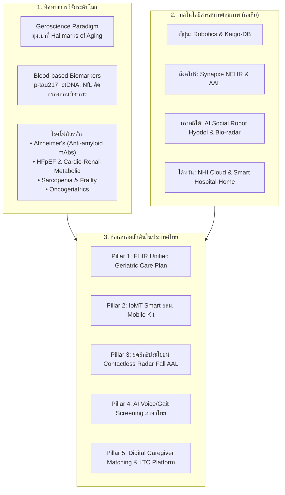

1. **ทิศทางการวิจัยระดับโลก (Global Research Paradigm Shift):** 
   - งานวิจัยทางการแพทย์ได้ย้ายศูนย์กลางจาก **"การรักษาโรคเฉพาะอวัยวะหลังเกิดอาการ" (Disease-Specific Late Intervention)** ไปสู่ **"Geroscience และเวชศาสตร์ชะลอวัยเชิงระบบ" (Targeting Molecular Hallmarks of Aging)** เพื่อขยายช่วงเวลาแห่งการมีสุขภาพดี (**Healthspan**) ให้ทัดเทียมกับอายุขัยขัยเฉลี่ย (**Lifespan**)
   - การตรวจวัดความเสื่อมถอยมุ่งเน้น **Intrinsic Capacity (ความสามารถเชิงหน้าที่ภายใน)** ตามกรอบ WHO ICOPE แทนการนับจำนวนโรคเพียงอย่างเดียว
   - การเกิดขึ้นของ **Blood-based Biomarkers** (เช่น p-tau217 สำหรับอัลไซเมอร์) และ **Multi-cancer Early Detection (Liquid Biopsy)** กำลังทำให้การตรวจคัดกรองเข้าสู่ระดับก่อนแสดงอาการ (Pre-clinical Stage)

2. **โรคเป้าหมายที่ทั่วโลกทุ่มงบประมาณวิจัยสูงสุด:**
   - **โรคระบบประสาทเสื่อม (Neurodegenerative Diseases):** ยุคทองของยาชีววัตถุกลุ่ม Anti-Amyloid Monoclonal Antibodies (Lecanemab, Donanemab) ควบคู่กับงานวิจัยด้าน Neuro-inflammation, Microglial homeostasis และ Gut-Brain Axis
   - **โรคหัวใจล้มเหลวชนิดการบีบตัวปกติ (HFpEF) และกลุ่มโรคหัวใจ-ไต-เมตาบอลิก:** ความสำเร็จของยากลุ่ม SGLT2 Inhibitors, GLP-1 Receptor Agonists และ Dual Incretin Co-agonists ในการลดอัตราตายและชะลอความเสื่อมของอวัยวะในผู้สูงอายุ
   - **กลุ่มอาการกล้ามเนื้อลีบ กระดูกพรุน และภาวะเปราะบาง (Sarcopenia, Osteoporosis & Frailty):** การวิจัยไมโอไคน์ (Myokines), ยาต้านการสลายตัวของกระดูกเจเนอเรชันใหม่ (Romosozumab), และโภชนบำบัดเชิงเวชศาสตร์ระดับเซลล์
   - **มะเร็งในผู้สูงอายุ (Oncogeriatrics):** การใช้แบบประเมินผู้สูงอายุแบบองค์รวม (CGA) เพื่อปรับขนาดยาเคมีบำบัดและยากลุ่ม Immunotherapy ตาม Biological Age แทน Chronological Age

3. **เทคโนโลยีสารสนเทศสุขภาพในเอเชีย (Asian Health IT Benchmarks):**
   - **ญี่ปุ่น:** การใช้หุ่นยนต์บริบาล (Nursing Care Robots) ภายใต้แผนยุทธศาสตร์ชาติ 8 ด้าน และการบูรณาการ Big Data การประกันดูแลระยะยาว (Kaigo-DB)
   - **สิงคโปร์:** ระบบเวชระเบียนอิเล็กทรอนิกส์แห่งชาติ (NEHR) ภายใต้องค์กร Synapxe, โครงการ SHINESeniors ที่ติดเซ็นเซอร์ IoT ในบ้านพักผู้สูงอายุของการเคหะแห่งชาติ (HDB), และ AI Tele-rehabilitation
   - **เกาหลีใต้:** การนำหุ่นยนต์ดูแลเพื่อนคู่คิดปัญญาประดิษฐ์ (AI Companion Robot: Hyodol) ประจำการในชุมชนกว่า 10,000 ครัวเรือน ช่วยลดคะแนนซึมเศร้าและเตือนกินยาได้แม่นยำ, การใช้เรดาร์คลื่นมิลลิเมตร (Bio-radar) ตรวจจับการล้มโดยไม่ละเมิดความเป็นส่วนตัว
   - **ไต้หวัน:** แพลตฟอร์ม NHI MediCloud ผสานข้อมูลยาและการตรวจทางห้องปฏิบัติการแบบ Real-time ร่วมกับความร่วมมือของบริษัทยักษ์ใหญ่ด้านฮาร์ดแวร์ (ASUS, Advantech, Acer) สร้างระบบ Hospital-to-Home

4. **ยุทธศาสตร์การผลักดันเทคโนโลยีสารสนเทศสุขภาพผู้สูงอายุในไทย (Strategic Blueprint):**
   - ประเทศไทยมี **"สินทรัพย์เชิงยุทธศาสตร์ที่หาได้ยากในระดับโลก"** คือ เครือข่ายอาสาสมัครสาธารณสุขประจำหมู่บ้าน (อสม.) กว่า 1.05 ล้านคน, ระบบบริการปฐมภูมิครอบคลุมถึงระดับตำบล (รพ.สต.), และระบบหลักประกันสุขภาพถ้วนหน้า (30 บาทรักษาทุกที่)
   - **ข้อเสนอ 5 เสาหลักเทคโนโลยีเร่งด่วน:**
     1. *Universal Geriatric Interoperability Gateway & FHIR Unified Care Plan:* ปลดล็อก Data Silos ระหว่าง HDC, 30 บาทรักษาทุกที่, หมอพร้อม, DMS Care, และกองทุน LTC ของ สปสช.
     2. *Smart Primary Care & IoMT-Powered อสม. Mobile Screening Kits:* ยกระดับ อสม. สู่ "Digital Health Navigators" ด้วยชุดคัดกรอง 9 ด้านดิจิทัลเชื่อมต่อคลาวด์
     3. *Subsidized Contactless In-Home Safety (Radar AAL):* บรรจุชุดเซ็นเซอร์เรดาร์ตรวจจับการล้มและสัญญาณชีพไร้สัมผัสในบ้าน เข้าเป็นชุดสิทธิประโยชน์หลักประกันสุขภาพเพื่อผู้สูงอายุกลุ่มเปราะบาง
     4. *AI Voice & Cognitive Biomarkers in Thai Language:* คัดกรองสมองเสื่อมระยะแรกผ่านเสียงพูดและการวิเคราะห์ภาษาไทยบนสมาร์ทโฟน/แท็บเล็ต
     5. *Digital Long-Term Care Coordination & Caregiver Matching Ecosystem:* แพลตฟอร์มจับคู่ผู้ดูแลที่ผ่านการรับรองและเบิกจ่ายงบประมาณดูแลระยะยาวแบบอัตโนมัติ

---

## ส่วนที่ 1: ทิศทางการวิจัยสุขภาพผู้สูงอายุระดับโลก (Global Geriatric Research Frontiers)

### 1.1 กระบวนทัศน์เปลี่ยนผ่าน: จาก Organ/Disease-Centric สู่ Geroscience & Longevity Medicine
ในอดีต งานวิจัยด้านเวชศาสตร์ผู้สูงอายุวางอยู่บนกรอบแนวคิดเชิงพยาธิสภาพแยกส่วนตามระบบอวัยวะ (Organ-Specific / Disease-Centric Model) เช่น แพทย์โรคหัวใจรักษาโรคหลอดเลือดหัวใจ, แพทย์ระบบประสาทรักษาโรคสมองเสื่อม, แพทย์ต่อมไร้ท่อรักษาเบาหวาน อย่างไรก็ตาม เมื่อเข้าสู่วัยสูงอายุ ปรากฏการณ์ **การเจ็บป่วยหลายโรคร่วม (Multimorbidity)** ส่งผลให้การรักษาตามแนวทางเวชปฏิบัติแบบแยกส่วนก่อให้เกิดปัญหาการใช้ยาซ้ำซ้อน (Polypharmacy), ปฏิกิริยาระหว่างยา (Drug-Drug Interactions), และการละเลยสมรรถนะการทำหน้าที่โดยรวมของผู้ป่วย

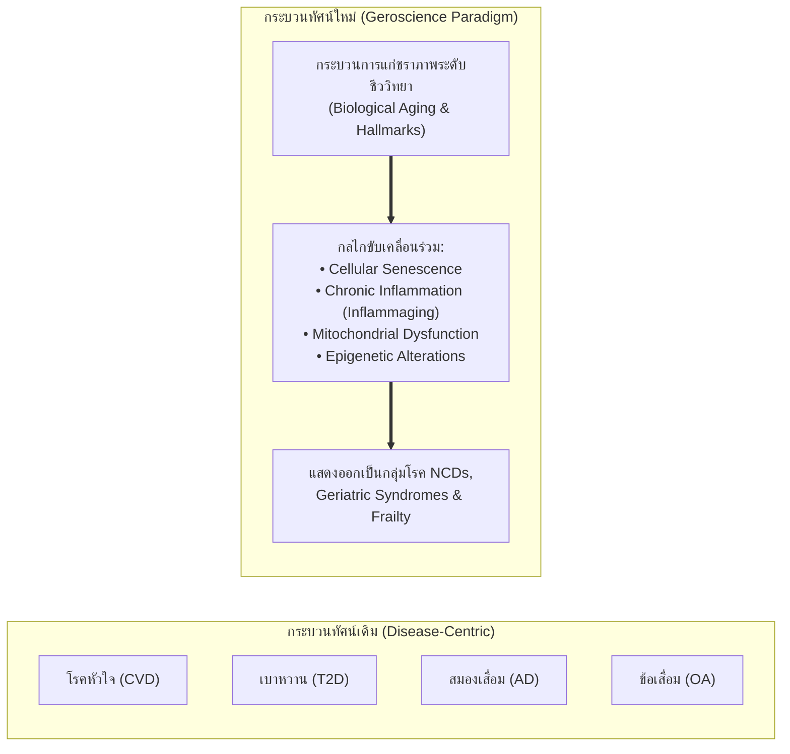

วงการวิจัยระดับโลกจึงเปลี่ยนผ่านสู่ **"Geroscience" (วิทยาศาสตร์ความชราภาพ)** ซึ่งตั้งสมมติฐานสำคัญว่า: *กระบวนการชราภาพทางชีววิทยา (Biological Aging) คือปัจจัยเสี่ยงปฐมภูมิที่ใหญ่ที่สุดของกลุ่มโรคไม่ติดต่อเรื้อรัง (NCDs) และความทุพพลภาพทั้งหมด* หากสามารถค้นพบกลไกและชะลอหรือย้อนกระบวนการแก่ชราภาพระดับเซลล์ได้ จะสามารถป้องกันหรือชะลอการเกิดโรคพร้อมกันได้หลายโรค (Concurrent Multi-Disease Prevention) และยืดขยายช่วงเวลาแห่งการมีสุขภาวะดี (**Healthspan**) ให้เข้าใกล้อายุขัยเฉลี่ย (**Lifespan**)

### 1.2 กลไกชีวโมเลกุลแห่งความชราภาพ (Hallmarks of Aging) และการแทรกแซงทางชีววิทยา
การปรับปรุงบทความทางวิชาการระดับแลนด์มาร์ก *"Hallmarks of Aging"* (ตีพิมพ์ในวารสาร Cell, 2023) ได้จำแนกกลไกความเสื่อมระดับเซลล์ออกเป็น 12 มิติสำคัญ ซึ่งเป็นทิศทางที่ห้องปฏิบัติการและบริษัทยาชีวภาพชั้นนำของโลก (อาทิ Calico, Altos Labs, Mayo Clinic Robert and Arlene Kogod Center on Aging) กำลังทุ่มเทการวิจัย:

| มิติกลไก (Hallmark) | พยาธิสรีรวิทยาในผู้สูงอายุ | ทิศทางและเป้าหมายการวิจัยเชิงการรักษา (Interventions in Clinical Trials) |
| :--- | :--- | :--- |
| **Cellular Senescence (เซลล์แก่ตัวค้าง)** | เซลล์หยุดแบ่งตัวแต่ไม่ตาย หลั่งสารอักเสบทำลายเนื้อเยื่อรอบข้าง (Senescence-Associated Secretory Phenotype: SASP) | การวิจัยยา **Senolytics** เพื่อกำจัดเซลล์แก่ (เช่น Dasatinib + Quercetin, Fisetin) และ **Senomorphics** เพื่อยับยั้งการหลั่ง SASP |
| **Telomere Attrition (การหดสั้นของเทโลเมียร์)** | ดีเอ็นเอส่วนปลายโครโมโซมสั้นลงจนถึงขีดจำกัด Hayflick ส่งผลให้เซลล์หยุดทำงาน | การศึกษาการแสดงออกของเอนไซม์ Telomerase ชั่วคราว และการใช้ยีนบำบัด (Gene therapy vectors) |
| **Epigenetic Alterations (การกลายรูปเอพิเจเนติกส์)** | การเปลี่ยนแปลงของ DNA methylation และ Histone modification ส่งผลต่อการแสดงออกของยีนที่ผิดเพี้ยน | ยาปรับสภาพเอพิเจเนติกส์, การรีโปรแกรมเซลล์บางส่วน (Partial Cellular Reprogramming ด้วย Yamanaka Factors: OSKM) |
| **Loss of Proteostasis & Autophagy Deficit** | การสะสมของโปรตีนที่มีโครงสร้างผิดปกติ (Misfolded proteins) และการเสื่อมของระบบขจัดขยะในเซลล์ | ยาฟื้นฟูระบบ Autophagy, Chaperone-mediated autophagy enhancers, Rapamycin และ mTOR inhibitors |
| **Mitochondrial Dysfunction** | ไมโทคอนเดรียผลิต ATP ลดลง ปลดปล่อย Reactive Oxygen Species (ROS) ทำลายเซลล์ | การเสริมสารตั้งต้น NAD+ (NMN, NR), สารต้านอนุมูลอิสระจำเพาะไมโทคอนเดรีย (MitoQ), Mitophagy inducers |
| **Chronic Systemic Inflammation ("Inflammaging")** | ภาวะอักเสบเรื้อรังระดับต่ำแบบไม่มีการติดเชื้อ เกิดจาก SASP, ขยะเซลล์ และความไม่สมดุลของจุลชีพในลำไส้ | การศึกษาแอนติบอดีต้าน IL-1β, IL-6, NLRP3 Inflammasome inhibitors, และการปรับสมดุล Gut Microbiota |

### 1.3 Intrinsic Capacity & Functional Ability ตามกรอบ WHO ICOPE
องค์การอนามัยโลก (WHO) ได้กำหนดแนวทาง **Integrated Care for Older People (ICOPE)** ซึ่งถือเป็นเสาหลักทางคลินิกที่สำคัญที่สุดของทศวรรษแห่งการสูงวัยอย่างมีสุขภาวะ (UN Decade of Healthy Ageing 2021–2030) โดยย้ายจุดเน้นจากการวินิจฉัย "โรค" มาเป็นการประเมินและฟื้นฟู **"ขีดความสามารถภายใน" (Intrinsic Capacity: IC)** 5 องค์ประกอบหลัก:

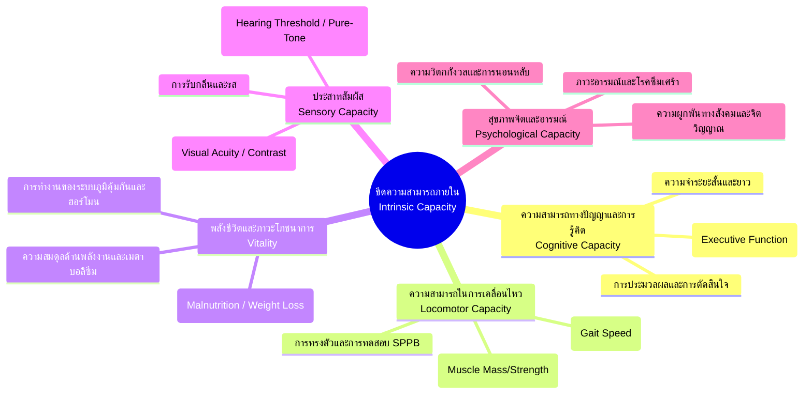

*งานวิจัยระบุชัดเจนว่า การลดลงของ Intrinsic Capacity ในมิติใดมิติหนึ่งเป็นตัวทำนายล่วงหน้า (Predictor) ของการก้าวเข้าสู่ภาวะเปราะบาง (Frailty), การสูญเสียความสามารถในการดำเนินกิจวัตรประจำวัน (ADL Dependency), การนอนโรงพยาบาล และการเสียชีวิตได้อย่างแม่นยำกว่าการวินิจฉัยโรคเดี่ยวๆ*

### 1.4 การปฏิวัติการวินิจฉัยระยะก่อนแสดงอาการด้วย Multi-Omics & Blood-Based Biomarkers
หนึ่งในทิศทางการวิจัยที่ก้าวกระโดดที่สุดในช่วงปี ค.ศ. 2023–2026 คือการค้นพบตัวบ่งชี้ชีวภาพในกระแสเลือด (Blood-Based Biomarkers: BBMs) ซึ่งเข้ามาทดแทนการตรวจที่สิ้นเปลือง รุกรานร่างกาย และเข้าถึงยาก (เช่น การเจาะน้ำไขสันหลัง Lumbar Puncture หรือการทำ PET-CT Scan):

1. **ระบบประสาทและสมองเสื่อม:**
   - **Plasma Phosphorylated Tau 217 (p-tau217):** ได้รับการยอมรับจากการวิจัยทางคลินิกขนาดใหญ่ (ตีพิมพ์ใน JAMA, 2024) ว่ามีความแม่นยำ (AUC > 0.95) เทียบเท่ากับการตรวจ Amyloid PET Scan ในการคัดกรองพยาธิสภาพของโรคอัลไซเมอร์ตั้งแต่ระยะ Mild Cognitive Impairment (MCI)
   - **Neurofilament Light Chain (NfL):** ตัวบ่งชี้การสลายตัวของเซลล์ประสาท (Neuronal Axonal Damage)
   - **Glial Fibrillary Acidic Protein (GFAP):** ตัวบ่งชี้ปฏิกิริยาการอักเสบของเซลล์แอสโทรไซต์ (Astrogliosis)
2. **การตรวจจับเซลล์ชราภาพและอายุทางชีวภาพ (Biological Age Clocks):**
   - **Epigenetic Clocks (Horvath Clock, GrimAge, PhenoAge, DunedinPACE):** การวัดระดับ DNA Methylation เพื่อคำนวณอัตราความเร็วของการแก่ชราภาพ (Rate of Biological Aging) เทียบกับอายุจริงตามปฏิทิน
   - **Plasma Proteomics Clocks:** การวิเคราะห์โปรตีนหลายพันชนิดพร้อมกัน (SomaScan, Olink) เพื่อประเมินอวัยวะที่มีการเสื่อมถอยเร็วกว่าปกติ (Organ-Specific Biological Aging เช่น Brain Age, Kidney Age, Heart Age)
3. **การตรวจคัดกรองมะเร็งระยะเริ่มต้นในผู้สูงวัย:**
   - **Multi-Cancer Early Detection (MCED) / Liquid Biopsy:** การตรวจชิ้นส่วนดีเอ็นเอของเซลล์มะเร็งที่ล่องลอยในกระแสเลือด (Circulating Tumor DNA: ctDNA) และรูปแบบการเกิด Methylation ทำให้สามารถคัดกรองมะเร็งได้มากกว่า 50 ชนิดพร้อมกันในการเจาะเลือดเพียงครั้งเดียว

### 1.5 ภาวะหลายโรคร่วม (Multimorbidity Trajectories) และ AI-Driven Algorithmic Deprescribing
ผู้สูงอายุทั่วโลกมากกว่าร้อยละ 60 มีโรคเรื้อรังตั้งแต่ 2 โรคขึ้นไป งานวิจัยสมัยใหม่ใช้เทคนิค Machine Learning และ Big Data ในการวิเคราะห์เส้นทางการเกิดโรคคู่ขนาน (Disease Trajectories & Clustering) ซึ่งพบรูปแบบสำคัญ 3 กลุ่ม:
* **Cardiometabolic Cluster:** ความดันโลหิตสูง + เบาหวานชนิดที่ 2 + ไขมันผิดปกติ + โรคไตเรื้อรัง + หัวใจล้มเหลว
* **Neuro-Psychiatric Cluster:** โรคซึมเศร้า + การนอนหลับผิดปกติ + การสูญเสียการได้ยิน + ภาวะสมองเสื่อม
* **Musculoskeletal-Frailty Cluster:** โรคข้อเข่าเสื่อม + กระดูกพรุน + มวลกล้ามเนื้อน้อย + ภาวะซึมเศร้าจากการจำกัดการเคลื่อนไหว

**วิกฤตการใช้ยาหลายขนาน (Polypharmacy):**  
การที่ผู้สูงอายุได้รับยาประจำตั้งแต่ 5 ถึง 10 ชนิดขึ้นไป เพิ่มความเสี่ยงของอาการไม่พึงประสงค์จากยา (ADRs), อาการสับสนเฉียบพลัน (Delirium), และการล้ม ทิศทางงานวิจัยจึงมุ่งเน้น **"Algorithmic Deprescribing"** โดยนำเกณฑ์มาตรฐานสากล (Beers Criteria ฉบับปรับปรุง 2023, STOPP/START Criteria เวอร์ชัน 3) มาผสานเข้ากับระบบสนับสนุนการตัดสินใจทางคลินิก (Clinical Decision Support Systems: CDSS) เพื่อแจ้งเตือนและแนะนำให้แพทย์ถอนยาที่ไม่เหมาะสม (Potentially Inappropriate Medications: PIMs) โดยอัตโนมัติ

### 1.6 ปัจจัยกำหนดสุขภาพทางสังคม (SDoH), ความเหงา และกลไก Neuro-Inflammation
งานวิจัยจาก U.S. Surgeon General และองค์การอนามัยโลก (WHO Commission on Social Connection 2024–2026) ยืนยันว่า **"ความเหงาและการแยกตัวทางสังคม" (Loneliness & Social Isolation)** ในผู้สูงอายุ ส่งผลเสียต่อสุขภาพเทียบเท่ากับการสูบบุหรี่วันละ 15 มวน โดยเพิ่มความเสี่ยงโรคหลอดเลือดหัวใจร้อยละ 29, สโตรกร้อยละ 32 และความเสี่ยงสมองเสื่อมสูงถึงร้อยละ 50
* **กลไกทางสรีรวิทยา:** ความเหงาก่อให้เกิดความเครียดเรื้อรัง กระตุ้นแกน HPA Axis (Hypothalamic-Pituitary-Adrenal) นำไปสู่การหลั่งคอร์ติซอลอย่างต่อเนื่อง เหนี่ยวนำการอักเสบในระบบประสาท (Neuro-inflammation) ทำลายเซลล์ประสาทในฮิปโปแคมปัส และเร่งการสะสมของคราบอะไมลอยด์

---

## ส่วนที่ 2: กลุ่มโรคและภาวะสุขภาพเป้าหมายหลักในงานวิจัยผู้สูงอายุ (Target Geriatric Diseases)

### 2.1 โรคระบบประสาทเสื่อมถอย (Neurodegenerative Diseases): อัลไซเมอร์ และยาสายชีววัตถุยุคใหม่
โรคอัลไซเมอร์ (Alzheimer's Disease: AD) และกลุ่มอาการสมองเสื่อมยังคงเป็นภาระทางสุขภาพและเศรษฐกิจที่รุนแรงที่สุดของระบบการดูแลระยะยาวทั่วโลก โดยปัจจุบันมีผู้ป่วยทั่วโลกกว่า 55 ล้านคน และคาดว่าจะเพิ่มเป็น 139 ล้านคนภายในปี ค.ศ. 2050

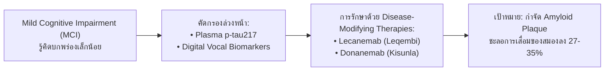

#### ความก้าวหน้าทางวิจัยที่พลิกโฉมประวัติศาสตร์:
1. **ยากลุ่ม Disease-Modifying Therapies (DMTs):**
   - **Lecanemab (Leqembi):** แอนติบอดีที่จับกับ soluble amyloid-beta protofibrils ได้รับการรับรองจาก US-FDA และหลายประเทศ สามารถชะลออัตราการเสื่อมถอยทางพุทธิปัญญาลงได้ 27% ในการทดลองระยะที่ 3 (Clarity AD)
   - **Donanemab (Kisunla):** มุ่งเป้ากำจัด N3pG amyloid plaques ชะลอความเสื่อมลงได้ถึง 35% ในผู้ป่วยระยะเริ่มต้นที่มีปริมาณโปรตีนเทา (Tau) ในสมองระดับต่ำถึงปานกลาง (TRAILBLAZER-ALZ 2)
   - **ข้อจำกัดและความท้าทาย:** ความเสี่ยงของการเกิดภาวะ Amyloid-Related Imaging Abnormalities (ARIA-E บวมน้ำในสมอง, ARIA-H เลือดออกขนาดเล็กในสมอง) ซึ่งต้องอาศัยการตรวจติดตามด้วย MRI อย่างใกล้ชิด และต้นทุนการรักษาที่สูงมาก
2. **Beyond Amyloid Hypothesis (ทิศทางวิจัยนอกเหนือจากอะไมลอยด์):**
   - การมุ่งเป้าที่ **Neuro-inflammation & Microglia:** การศึกษายีน TREM2, CD33 และการทำงานของเซลล์ไมโครเกลียในการทำความสะอาดขยะโปรตีน
   - **Vascular Cognitive Impairment (VCI):** บทบาทของความสมบูรณ์ของหลอดเลือดสมองส่วนเชื่อมต่อ (Blood-Brain Barrier: BBB breakdown) และโรคหลอดเลือดสมองขนาดเล็ก (Cerebral Small Vessel Disease: CSVD)
   - **Gut-Microbiota-Brain Axis:** การผลิตสารสื่อประสาทและโมเลกุลกระตุ้นการอักเสบจากลำไส้ที่ส่งผลผ่านเส้นประสาทเวกัส (Vagus nerve)

### 2.2 โรคหัวใจหลอดเลือด เมตาบอลิก และไต (Cardio-Renal-Metabolic & HFpEF)
ในกลุ่มโรคหัวใจและหลอดเลือด ผู้สูงอายุเผชิญกับรูปแบบพยาธิสภาพที่แตกต่างจากวัยหนุ่มสาวอย่างมีนัยสำคัญ:

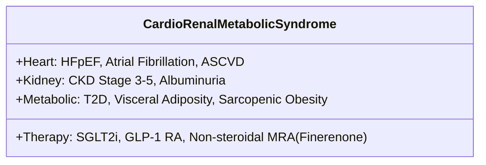

1. **Heart Failure with Preserved Ejection Fraction (HFpEF):**
   - ในผู้ป่วยสูงอายุที่มีภาวะหัวใจล้มเหลว มากกว่าร้อยละ 50 เป็นชนิด HFpEF (หัวใจห้องล่างซ้ายบีบตัวปกติ แต่คลายตัวผิดปกติเนื่องจากกล้ามเนื้อหัวใจหนาตัว แข็ง และเกิดพังผืด)
   - **จุดเปลี่ยนสำคัญของงานวิจัย:** การค้นพบว่ายากลุ่ม **SGLT2 Inhibitors** (Empagliflozin ในการทดลอง EMPEROR-Preserved และ Dapagliflozin ในการทดลอง DELIVER) สามารถลดอัตราการนอนโรงพยาบาลและการเสียชีวิตจากโรคหัวใจได้อย่างมีนัยสำคัญทางสถิติ ถือเป็นยาขนานแรกในประวัติศาสตร์ที่รักษา HFpEF ได้ผล
   - **GLP-1 Receptor Agonists (Semaglutide):** การทดลอง STEP-HFpEF (2023–2024) พิสูจน์ว่า Semaglutide ช่วยลดอาการเหนื่อย น้ำหนักตัว และยกระดับคุณภาพชีวิตในผู้สูงอายุที่เป็นโรคอ้วนร่วมกับ HFpEF
2. **โรคหัวใจเต้นพลิ้วระริก (Atrial Fibrillation: AF) และ Stroke Prevention:**
   - ความชุกของ AF เพิ่มขึ้นแตะร้อยละ 10–12 ในประชากรอายุ 80 ปีขึ้นไป เป็นสาเหตุสำคัญของ Cardioembolic Stroke การใช้ยาต้านการแข็งตัวของเลือดกลุ่ม NOACs/DOACs (Apixaban, Rivaroxaban, Edoxaban, Dabigatran) ได้รับการวิจัยยืนยันว่ามีความปลอดภัยและลดภาวะเลือดออกในสมองได้ดีกว่า Warfarin อย่างชัดเจนในกลุ่มผู้สูงอายุเปราะบาง
3. **Cardio-Renal-Metabolic Interconnection:**
   - การใช้ยา **Non-steroidal Mineralocorticoid Receptor Antagonist (Finerenone)** ร่วมกับ SGLT2i ช่วยชะลอการเสื่อมของไต (CKD Progression) และลดความเสี่ยงโรคหัวใจในผู้สูงอายุที่เป็นเบาหวานได้อย่างมีนัยสำคัญ

### 2.3 ระบบกระดูก กล้ามเนื้อ และกลุ่มอาการผู้สูงอายุ (Sarcopenia, Osteoporosis, Frailty)
การเคลื่อนไหว (Mobility) คือหัวใจหลักของการพึ่งพาตนเองของผู้สูงอายุ งานวิจัยระดับนานาชาติมุ่งเน้นการยุติวงจรอุบาทว์ของความเสื่อมถอยทางกายภาพ:

| ภาวะ / โรค | เกณฑ์การวินิจฉัยตามฉันทามติสากล (Consensus Criteria) | ความก้าวหน้าทางการวิจัยและการแทรกแซง |
| :--- | :--- | :--- |
| **Sarcopenia (ภาวะมวลกล้ามเนื้อน้อย)** | Asian Working Group for Sarcopenia (AWGS 2019):<br/>• แรงบีบมือ (Grip Strength) < 28 กก. (ชาย), < 18 กก. (หญิง)<br/>• 5-Time Chair Stand Test $\ge$ 12 วินาที<br/>• มวลกล้ามเนื้อ (ASM/height$^2$) ตรวจด้วย BIA หรือ DXA | การวิจัยโมเลกุล **Myostatin/Activin A Inhibitors**, สารเสริมอนุพันธ์กรดอะมิโนจำเป็น (Leucine-enriched essential amino acids), การออกกำลังกายแบบมีแรงต้าน (Resistance Training) ร่วมกับการกระตุ้นด้วยกระแสไฟฟ้า (Neuromuscular Electrical Stimulation: NMES) |
| **Osteoporosis (โรคกระดูกพรุน)** | T-score $\le$ -2.5 จากการตรวจ DXA หรือกระดูกหักจากแรงกระแทกเบา (Fragility Fracture) | การเปลี่ยนผ่านจากการใช้ยากลุ่มยับยั้งการสลายกระดูก (Antiresorptive) เพียงอย่างเดียว สู่การใช้ยา **สร้างกระดูก (Bone Anabolic Agents)** เช่น Romosozumab (Anti-sclerostin antibody) และ Teriparatide ในผู้ที่มีความเสี่ยงกระดูกหักระดับสูงมาก |
| **Frailty Syndrome (ภาวะเปราะบาง)** | Fried Frailty Phenotype (ล้า, อ่อนแรง, เดินช้า, กิจกรรมลด, น้ำหนักลดไม่ได้ตั้งใจ) หรือ Rockwood Frailty Index | การวิจัยโปรโตคอลการฟื้นฟูสมรรถภาพแบบผสมผสานหลายมิติ (Multicomponent Exercise: Aerobic + Resistance + Balance) ร่วมกับโภชนบำบัดโปรตีนสูง (1.2–1.5 กรัม/กก./วัน) และการรักษาโรคเรื้อรังแฝง |

### 2.4 มะเร็งในผู้สูงอายุ (Oncogeriatrics & Comprehensive Geriatric Assessment: CGA)
มากกว่าร้อยละ 60 ของผู้ป่วยมะเร็งรายใหม่ และมากกว่าร้อยละ 70 ของการเสียชีวิตจากมะเร็ง เกิดขึ้นในประชากรอายุ 65 ปีขึ้นไป
* **การเปลี่ยนผ่านการตัดสินใจ:** สมาคมมะเร็งวิทยาผู้สูงอายุสากล (SIOG) และ ASCO กำหนดให้ใช้ **Comprehensive Geriatric Assessment (CGA)** ในการประเมินผู้ป่วยสูงอายุทุกรายก่อนเริ่มการรักษามะเร็ง เพื่อจำแนกว่าผู้ป่วยรายใดเป็นกลุ่ม "Fit" (รับการรักษามาตรฐานได้เต็มที่), "Vulnerable" (ต้องปรับลดขนาดยาและให้การดูแลเสริม), หรือ "Frail" (เน้นการดูแลแบบประคับประคอง Palliative Care)
* **Immunotherapy in the Elderly:** การวิจัยพบว่ายากลุ่ม Immune Checkpoint Inhibitors (PD-1/PD-L1, CTLA-4 inhibitors) มีประสิทธิภาพในผู้สูงอายุใกล้เคียงกับวัยหนุ่มสาว แต่ต้องระวังผลข้างเคียงจากภูมิคุ้มกันทำลายตนเอง (Immune-Related Adverse Events: irAEs) เนื่องจากภาวะภูมิคุ้มกันแปรปรวนในวัยชรา

### 2.5 ภาวะภูมิคุ้มกันถดถอยตามวัย (Immunosenescence) และวัคซีนจำเพาะผู้สูงวัย
กระบวนการชราภาพของระบบภูมิคุ้มกัน (Immunosenescence) ทำให้ผู้สูงอายุตอบสนองต่อเชื้อโรคและวัคซีนลดลงอย่างมาก เกิดการลดลงของ Naive T-cells และการสะสมของ Terminally differentiated senescent cells งานวิจัยจึงพัฒนา **วัคซีนเทคโนโลยีขั้นสูงที่ออกแบบมาเพื่อผู้สูงอายุโดยเฉพาะ**:
* **วัคซีนป้องกันไวรัส RSV (Respiratory Syncytial Virus):** การอนุมัติวัคซีนชนิด Adjuvanted Recombinant Subunit Vaccine (Arexvy) และ Bivalent Recombinant Vaccine (Abrysvo) ซึ่งมีประสิทธิผลในการป้องกันการติดเชื้อทางเดินหายใจส่วนล่างในผู้สูงอายุเกินร้อยละ 82–94
* **วัคซีนป้องกันงูสวัด (Recombinant Zoster Vaccine: Shingrix):** ใช้นวัตกรรมสารเสริมฤทธิ์ AS01B Adjuvant ให้ประสิทธิภาพป้องกันอาการปวดปลายประสาท (Post-herpetic neuralgia) ได้ยาวนานเกิน 10 ปี ด้วยประสิทธิผลมากกว่าร้อยละ 90 แม้ในผู้สูงอายุวัยปลาย (>80 ปี)
* **High-Dose / Adjuvanted Influenza Vaccine:** การเพิ่มปริมาณแอนติเจน 4 เท่าเพื่อกระตุ้นแอนติบอดีในระบบภูมิคุ้มกันที่เสื่อมสภาพ
* **Next-Gen Pneumococcal Conjugate Vaccines (PCV20, PCV21):** ครอบคลุมสายพันธุ์เชื้อสเตรปโตคอคคัส นิวโมเนียอี ที่ก่อโรคปอดอักเสบและติดเชื้อในกระแสเลือดได้ครอบคลุมยิ่งขึ้น

### 2.6 ความเสื่อมถอยของประสาทสัมผัส (Sensory Deprivation) กับความเสี่ยงสมองเสื่อม
รายงานคณะกรรมาธิการแลนเซ็ตเพื่อการป้องกัน รักษา และดูแลภาวะสมองเสื่อม (Lancet Commission on Dementia 2024 Update) ยืนยันว่า **"การสูญเสียการได้ยิน" (Hearing Loss)** และ **"การสูญเสียการมองเห็นที่ไม่ได้รับการแก้ไข" (Uncorrected Vision Loss)** เป็นปัจจัยเสี่ยงอันดับ 1 ของภาวะสมองเสื่อมที่สามารถป้องกันได้ในวัยกลางคนและวัยสูงอายุ
* **ผลงานวิจัย ACHIEVE Study (Lancet 2023):** การใส่เครื่องช่วยฟัง (Hearing Aids) ในผู้สูงอายุที่มีความเสี่ยงสมองเสื่อม สามารถชะลออัตราการเสื่อมของความจำและการรู้คิดลงได้ถึง **ร้อยละ 48 ในระยะเวลา 3 ปี** เนื่องจากการได้ยินช่วยรักษาการกระตุ้นของเซลล์ประสาทในสมอง (Auditory Cortex) และลดภาระการรู้คิด (Cognitive Load) ในการตีความเสียง

---

## ส่วนที่ 3: ภูมิทัศน์เทคโนโลยีสารสนเทศด้านสุขภาพผู้สูงอายุระดับโลก (Global Geriatric Health IT Landscape)

### 3.1 สถาปัตยกรรมระบบสารสนเทศสุขภาพเพื่อการสูงวัย (Health IT Architectural Pillars)
ระบบสารสนเทศสุขภาพสำหรับผู้สูงอายุในยุคปัจจุบัน ได้วิวัฒนาการจากระบบจัดเก็บข้อมูลนิ่ง (Static Record Systems) ไปสู่ **"ระบบนิเวศอัจฉริยะที่ตอบสนองแบบพลวัต" (Dynamic, Ambient, and Continuous Care Ecosystem)** ซึ่งประกอบด้วย 5 ชั้นสถาปัตยกรรม (5-Tier Architecture):

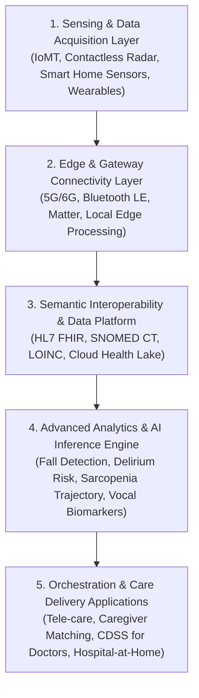

### 3.2 ระบบเฝ้าระวังสิ่งแวดล้อมและเซ็นเซอร์ไร้สัมผัส (Ambient Assisted Living & Contactless Sensing)
หนึ่งในปัญหาใหญ่ที่สุดของอุปกรณ์เฝ้าระวังผู้สูงอายุแบบดั้งเดิม (เช่น นาฬิกาสมาร์ทวอทช์ หรือปุ่มกดฉุกเฉินห้อยคอ) คือ **"อัตราการปฏิเสธการใช้งาน" (Device Abandonment / Non-compliance)** โดยผู้สูงอายุมักลืมสวมใส่ รู้สึกรำคาญ ถอดออกก่อนอาบน้ำหรือเข้านอน ซึ่งเป็นช่วงเวลาที่เกิดอุบัติเหตุการล้มบ่อยที่สุด วงการเทคโนโลยีระดับโลกจึงมุ่งเน้น **Contactless Ambient Sensing**:

1. **เทคโนโลยีเรดาร์คลื่นมิลลิเมตร (Millimeter-Wave / mmWave Radar 60GHz - 77GHz):**
   - ส่งคลื่นวิทยุความถี่สูงสะท้อนการเคลื่อนไหวของร่างกาย สามารถจำแนกความแตกต่างระหว่างการนั่งลงอย่างรวดเร็ว กับการล้มกระแทกพื้น (Fall Detection) ด้วยความแม่นยำสูง (> 98%)
   - **ตรวจวัดสัญญาณชีพไร้สัมผัส (Contactless Vitals):** ตรวจจับการกระเพื่อมของหน้าอกเพื่อวัดอัตราการหายใจ (Respiratory Rate) และการเต้นของหัวใจ (Ballistocardiography) ขณะนอนหลับ โดยไม่ต้องมีสายระโยงระยาง
   - **Privacy-Preserving:** ไม่มีการบันทึกภาพถ่ายหรือวิดีโอเหมือนกล้องวงจรปิด จึงติดตั้งในห้องนอนและห้องน้ำได้อย่างปลอดภัย ไร้ข้อกังวลด้าน PDPA / ละเมิดสิทธิส่วนบุคคล
2. **ระบบวิเคราะห์ลายเซ็นพลังงานและกิจกรรม (Smart Home Passive Infrared & Energy Signature):**
   - ติดตั้งเซ็นเซอร์ตรวจจับการเปิด-ปิดตู้เย็น ประตูห้องน้ำ หรือการใช้เครื่องใช้ไฟฟ้า เพื่อสร้างเส้นฐานพฤติกรรมปกติ (Routine Activity Baseline) หากพบความผิดปกติ เช่น ไม่เข้าห้องน้ำนานเกิน 8 ชั่วโมง หรือเปิดตู้เย็นตอนกลางคืนบ่อยผิดปกติ ระบบจะส่งสัญญาณเตือนบุตรหลานหรือผู้ดูแล

### 3.3 การติดตามผู้ป่วยทางไกลและระบบอุปกรณ์การแพทย์เชื่อมต่อ (RPM & IoMT)
การดูแลผู้สูงอายุที่มีโรคเรื้อรังซับซ้อนกำลังเปลี่ยนสู่โมเดล **Hospital-at-Home (HaH)** และ **Continuous Remote Patient Monitoring (RPM)**:
* **เครื่องวัดความดันและน้ำตาลเชื่อมต่อสัญญาณเซลลูลาร์ (Cellular-connected Hubs):** ข้อมูลความดันโลหิตและระดับน้ำตาลถูกส่งตรงเข้าสู่คลาวด์โรงพยาบาลทันทีที่วัดเสร็จ โดยผู้สูงอายุไม่ต้องเชื่อมต่อบลูทูธหรือใช้สมาร์ทโฟนเป็นตัวกลาง (Zero-Setup Deployment)
* **Continuous Glucose Monitoring (CGM) in Geriatrics:** การใช้เซ็นเซอร์ติดผิวหนังตรวจวัดน้ำตาลแบบเรียลไทม์เพื่อเตือนภาวะน้ำตาลในเลือดต่ำรุนแรง (Severe Hypoglycemia) ซึ่งเป็นสาเหตุสำคัญของการหมดสติ การล้ม และสมองขาดน้ำตาลในผู้สูงอายุที่ใช้ยาอินซูลินหรือยากลุ่มซัลโฟนิลยูเรีย
* **Wearable Single/6-Lead ECG:** การตรวจจับภาวะหัวใจเต้นระริก (Silent AF) เพื่อป้องกันอัมพฤกษ์อัมพาต

### 3.4 ปัญญาประดิษฐ์ตรวจคัดกรองความเสี่ยงและตัวบ่งชี้ชีวภาพดิจิทัล (AI & Digital Biomarkers)
การใช้ปัญญาประดิษฐ์ในการประมวลผลข้อมูลทางพฤติกรรม สรีรวิทยา และการทำงานของระบบประสาท:
* **Vocal & Speech Biomarkers:** ใช้อัลกอริทึม Natural Language Processing (NLP) และ Acoustic Analysis วิเคราะห์การสั่นของเส้นเสียง ช่องว่างความเงียบระหว่างคำ (Hesitation Pauses), ความหลากหลายของคำศัพท์ (Lexical Diversity), และความเร็วในการตอบสนอง เพื่อทำนายภาวะ Mild Cognitive Impairment (MCI) และภาวะซึมเศร้า
* **Computer Vision Gait Analysis:** การใช้กล้องสมาร์ทโฟนถ่ายวิดีโอการเดินของผู้สูงอายุ 5–10 เมตร ระบบ AI จะคำนวณความเร็วในการเดิน (Gait Speed), ระยะก้าว (Stride Length), ความแกว่งของการทรงตัว (Trunk Oscillation) เพื่อตรวจหาภาวะ Sarcopenia และประเมินความเสี่ยงการล่วงล้มล่วงหน้า
* **EHR-based Early Warning Scores for Geriatric Delirium:** โมเดลทำนายการเกิดภาวะสับสนเฉียบพลันในหอผู้ป่วย โดยวิเคราะห์ข้อมูลการใช้ยา ผลแล็บ ค่าโซเดียม และสัญญาณชีพ

### 3.5 ดิจิทัลเธอราพิวติกส์และการฟื้นฟูระบบประสาท (Digital Therapeutics: DTx)
ซอฟต์แวร์ทางการแพทย์ที่ได้รับการรับรองให้ใช้รักษาโรค (Prescription Digital Therapeutics: PDTx) กำลังมีบทบาทอย่างยิ่งในเวชศาสตร์ผู้สูงอายุ:
* **Gamified Cognitive Training:** โปรแกรมเกมฝึกสมองที่ปรับระดับความยากตามความสามารถของผู้ป่วยแบบเรียลไทม์ เพื่อกระตุ้น Neuroplasticity ชะลอความเสื่อมถอยของการรู้คิด
* **Digital CBT-I (Cognitive Behavioral Therapy for Insomnia):** การใช้แอปพลิเคชันบำบัดโรคนอนไม่หลับ ช่วยลดการใช้ยานอนหลับกลุ่มเบนโซไดอะซีปีน (Benzodiazepines) ซึ่งเป็นตัวการสำคัญที่ทำให้ผู้สูงอายุพลัดตกหกล้มและเกิดสมองเสื่อม
* **AI-Guided Telerehabilitation:** ระบบภาพเสมือนจริงที่ตรวจจับมุมข้อต่อและนำทางการออกกำลังกายฟื้นฟูกล้ามเนื้อและข้อต่อที่บ้าน พร้อมส่งรายงานความก้าวหน้าให้นักกายภาพบำบัด

### 3.6 มาตรฐานการแลกเปลี่ยนข้อมูลสุขภาพและการดูแลต่อเนื่อง (HL7 FHIR Interoperability)
หัวใจสำคัญของเทคโนโลยีสุขภาพผู้สูงอายุคือ **"ความต่อเนื่องของการดูแล" (Continuity of Care)** ข้อมูลสุขภาพต้องเดินทางไปพร้อมกับตัวผู้สูงอายุ ไม่ว่าจะพักอยู่ที่บ้าน รับการรักษาที่โรงพยาบาล หรือฟื้นฟูที่ศูนย์ดูแลระยะยาว:
* **HL7 FHIR (Fast Healthcare Interoperability Resources):** มาตรฐานสากลที่กำหนด Resource เฉพาะสำหรับการดูแลผู้สูงอายุ เช่น:
  - `Observation`: บันทึกคะแนน Barthel ADL, Frailty Index, สัญญาณชีพ
  - `CarePlan`: แผนการดูแลรายบุคคลที่มีการกำหนดเป้าหมายร่วมกันระหว่างแพทย์ พยาบาล ผู้จัดการการดูแล (Care Manager) และครอบครัว
  - `MedicationStatement`: ประวัติการใช้ยาทั้งหมดเพื่อป้องกันการสั่งยาซ้ำซ้อน
* **SMART on FHIR:** แอปพลิเคชันที่สามารถเสียบต่อ (Plug-and-Play) เข้ากับระบบโรงพยาบาล (EHR) แห่งใดก็ได้ เพื่อดึงข้อมูลมาแสดงผลแดชบอร์ดสุขภาพผู้สูงอายุ

### 3.7 หุ่นยนต์ดูแล ฟื้นฟู และช่วยเหลือทางสังคม (Care & Assistive Robotics)
แบ่งออกเป็น 3 หมวดหมู่หลัก:
1. **Transfer & Mobility Robotics:** โครงกระดูกภายนอกกลไก (Exoskeletons เช่น Cyberdyne HAL) ช่วยพยุงลุกยืนและฝึกเดิน, เตียงอัจฉริยะที่สามารถแปลงร่างเป็นรถเข็นอัตโนมัติ (Panasonic Resyone) เพื่อลดภาระของผู้ดูแลในการอุ้มย้ายตัว
2. **Hygiene & Personal Care Robotics:** หุ่นยนต์ช่วยขับถ่ายและสุขอนามัยอัตโนมัติ ช่วยลดปัญหาแผลกดทับและการติดเชื้อ
3. **Social & Cognitive Companion Robots:** หุ่นยนต์แมวน้ำบำบัด (PARO), หุ่นยนต์ตุ๊กตาอัจฉริยะ (Hyodol, ElliQ) ที่สนทนากับผู้สูงอายุ กระตุ้นให้มีปฏิสัมพันธ์ ตรวจสอบอารมณ์ และเตือนกินยา

---

## ส่วนที่ 4: กรณีศึกษาเชิงเปรียบเทียบในภูมิภาคเอเชีย (Comparative Asian Benchmarks)

ภูมิภาคเอเชียเป็นศูนย์กลางการพัฒนานวัตกรรมเทคโนโลยีเพื่อผู้สูงอายุที่ล้ำหน้าที่สุดในโลก เนื่องจากมีประเทศที่ก้าวเข้าสู่ Super-Aged Society เร็วที่สุด

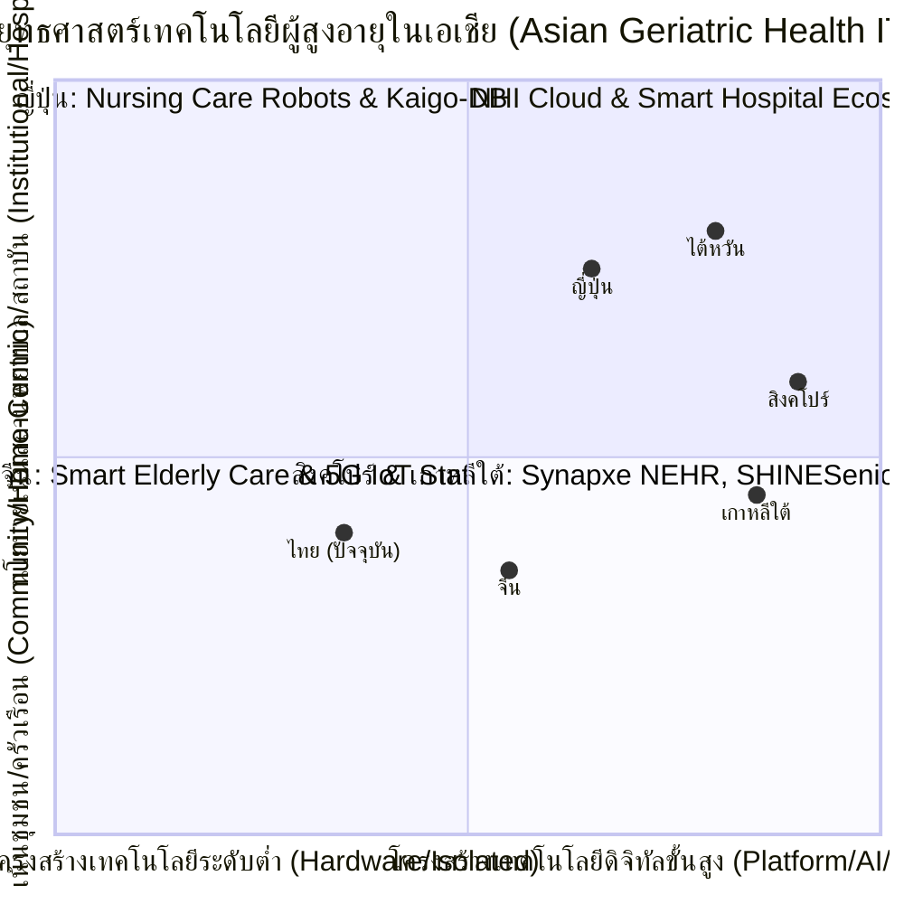

### 4.1 ประเทศญี่ปุ่น (Japan): ผู้นำ Society 5.0, Nursing Care Robotics และ Kaigo-DB
ญี่ปุ่นเป็นประเทศที่มีสัดส่วนประชากรสูงอายุสูงที่สุดในโลก (ประชากรอายุ 65 ปีขึ้นไปสูงกว่า 29%) และเป็นผู้บุกเบิกยุทธศาสตร์ **Society 5.0**:
* **National Project for Promoting the Introduction of Nursing Care Robots:** กระทรวงสาธารณสุข แรงงาน และสวัสดิการของญี่ปุ่น (MHLW) กำหนด 8 หมวดหมู่นวัตกรรมหุ่นยนต์ดูแลที่รัฐให้เงินอุดหนุนแก่สถานบริบาลผู้สูงอายุ เช่น หุ่นยนต์ช่วยพยุงยกตัว, หุ่นยนต์ช่วยอาบน้ำ, เซ็นเซอร์ตรวจจับการล้มและติดตามพฤติกรรมบนเตียง
* **Kaigo-DB (Long-Term Care Database):** ฐานข้อมูลแห่งชาติที่เชื่อมโยงข้อมูลการเบิกจ่ายประกันการดูแลระยะยาว (LTCI) เข้ากับฐานข้อมูลการรักษาพยาบาล (NDB) ทำให้รัฐบาลญี่ปุ่นมีข้อมูลบิ๊กดาต้าระดับประชากรที่สามารถทำนายแนวโน้มภาวะพึ่งพิง และวัดประสิทธิผลของการฟื้นฟูสมรรถภาพในผู้สูงอายุรายบุคคลได้อย่างละเอียด

### 4.2 ประเทศสิงคโปร์ (Singapore): Healthier SG, Synapxe NEHR, SHINESeniors Smart Homes
สิงคโปร์ใช้ข้อได้เปรียบของการเป็นนครรัฐ (City-State) ในการวางโครงสร้างพื้นฐานระดับชาติอย่างเป็นเอกภาพ:
* **National Electronic Health Record (NEHR) ภายใต้ Synapxe (iHiS เดิม):** ประวัติสุขภาพของผู้สูงอายุเชื่อมโยงกันอย่างไร้รอยต่อระหว่างโรงพยาบาลรัฐ คลินิกเอกชน และศูนย์ดูแลผู้สูงอายุในชุมชน ภายใต้ยุทธศาสตร์ "Healthier SG" ที่ให้ความสำคัญกับการดูแลเชิงป้องกัน
* **SHINESeniors Project (Smart Homes for Elders):** รัฐบาลร่วมกับมหาวิทยาลัย SMU ติดตั้งเครือข่ายเซ็นเซอร์แบบไม่ล่วงล้ำ (Passive Motion Sensors) ในห้องชุดของการเคหะแห่งชาติ (HDB) ที่มีผู้สูงอายุอาศัยอยู่ตามลำพัง เพื่อตรวจจับรูปแบบพฤติกรรมประจำวัน และส่งข้อความเตือนไปยังกลุ่มอาสาสมัครในละแวกบ้านเมื่อพบความผิดปกติ
* **AI Tele-Rehabilitation:** การใช้ระบบคอมพิวเตอร์วิทัศน์ตรวจสอบการฝึกกายภาพบำบัดหลังสโตรกที่บ้าน เพื่อลดความแออัดในโรงพยาบาล

### 4.3 ประเทศเกาหลีใต้ (South Korea): หุ่นยนต์อัจฉริยะ Hyodol, Smart Senior Centers, Bio-Radar
เกาหลีใต้กำลังจะกลายเป็นประเทศที่มีผู้สูงอายุสัดส่วนสูงที่สุดในโลกภายในปี 2045 จึงเร่งพัฒนาดิจิทัลเชิงรุก:
* **AI Social Robot "Hyodol" (ฮโยดล):** หุ่นยนต์ตุ๊กตาผ้าอัจฉริยะที่ติดตั้ง AI และเซ็นเซอร์สัมผัส ถูกนำไปใช้งานในบ้านผู้สูงอายุที่มีภาวะซึมเศร้าหรืออยู่ตามลำพังกว่า 10,000 หลังคาเรือน ผ่านการสนับสนุนจากเทศบาลเมือง หุ่นยนต์ทำหน้าที่พูดคุยด้วยภาษาเกาหลี เตือนกินยา ร้องเพลง ชวนทำกิจกรรม และแจ้งเตือนฉุกเฉินหากไม่มีการสัมผัสหรือเคลื่อนไหวนานเกินกำหนด การศึกษาทางคลินิกพบว่าช่วยลดคะแนนภาวะซึมเศร้าของผู้สูงอายุลงได้ถึงร้อยละ 40
* **Bio-Radar Fall Prevention in Smart Senior Centers:** การติดตั้งเรดาร์คลื่นมิลลิเมตรในศูนย์สวัสดิการผู้สูงอายุทุกเขต เพื่อตรวจจับการล้มและเฝ้าระวังความแออัด
* **MyHealthWay Platform:** แอปพลิเคชันรวมข้อมูลสุขภาพส่วนบุคคลระดับชาติ ให้ผู้สูงอายุและครอบครัวสามารถเข้าถึงประวัติการใช้ยาและการตรวจแล็บจากทุกโรงพยาบาลได้ในที่เดียว

### 4.4 ไต้หวัน (Taiwan): NHI MediCloud Big Data, Smart Hospital-to-Home, นิเวศเทคโนโลยีไอที
ไต้หวันใช้ความแข็งแกร่งด้านอุตสาหกรรมเซมิคอนดักเตอร์และฮาร์ดแวร์ไอที เชื่อมต่อกับระบบประกันสุขภาพแห่งชาติ:
* **NHI MediCloud System:** ระบบคลาวด์ประกันสุขภาพแห่งชาติที่แพทย์และเภสัชกรสามารถตรวจสอบประวัติการใช้ยาและการรักษาข้ามโรงพยาบาลได้แบบเรียลไทม์ ป้องกันปัญหา Polypharmacy และการสั่งยาซ้ำซ้อนได้อย่างสมบูรณ์แบบที่สุดในเอเชีย
* **Hospital-to-Home Smart Continuum:** บริษัทเทคโนโลยีชั้นนำ (เช่น ASUS, Advantech, Acer, BenQ Medical) จับมือกับโรงพยาบาลมหาวิทยาลัย พัฒนาฮาร์ดแวร์ตรวจวัดทางคลินิกที่ใช้งานง่ายที่บ้าน ส่งข้อมูลเข้าสู่แดชบอร์ดศูนย์บัญชาการเสมือน (Virtual Care Command Center) ของแพทย์เวชศาสตร์ครอบครัว

### 4.5 ประเทศจีน (China): ยุทธศาสตร์ 90-7-3, 智慧养老 (Smart Elderly Care), 5G AI Triage
จีนต้องรับมือกับประชากรสูงอายุมากกว่า 280 ล้านคน จึงใช้ยุทธศาสตร์การพัฒนาแบบก้าวกระโดด:
* **โมเดล 90-7-3:** ร้อยละ 90 อยู่บ้าน, ร้อยละ 7 อยู่ศูนย์ชุมชน, ร้อยละ 3 อยู่สถานบริบาล
* **Smart Elderly Care (智慧养老):** การบูรณาการอุปกรณ์ IoT สวมใส่, 5G, และแอปพลิเคชัน WeChat Mini-programs เพื่อให้ผู้สูงอายุในชุมชนสามารถกดปุ่มเรียกบริการส่งอาหาร การพยาบาล หรือบริการฉุกเฉินถึงบ้านได้ภายใน 15 นาที
* **AI Kiosk ในสถานีอนามัยชนบท:** ระบบตู้ตรวจสุขภาพอัจฉริยะที่ใช้ AI ช่วยคัดกรองเบาหวาน ความดัน สโตรก และเชื่อมต่อแพทย์ทางไกลจากโรงพยาบาลตติยภูมิชั้นนำในปักกิ่งและเซี่ยงไฮ้

### 4.6 ตารางสังเคราะห์เปรียบเทียบข้ามประเทศ (Cross-Country Benchmark Matrix)

| มิติการเปรียบเทียบ | ประเทศญี่ปุ่น | ประเทศสิงคโปร์ | ประเทศเกาหลีใต้ | ไต้หวัน | ประเทศไทย (สถานะปัจจุบัน) |
| :--- | :--- | :--- | :--- | :--- | :--- |
| **สัดส่วนประชากร 65+** | ~29.1% (Super-Aged) | ~19.0% (Aged) | ~19.5% (Aged) | ~18.5% (Aged) | **~15.5% (65+) / ~21.3% (60+)** |
| **ระบบฐานข้อมูลหลัก** | Kaigo-DB + NDB | Synapxe NEHR | MyHealthWay + K-NHIS | NHI MediCloud | **HDC (แยกส่วน) + หมอพร้อม** |
| **จุดเด่นทางเทคโนโลยี** | Nursing Robots / เตียงกลไก / Smart Diapers | Passive Home AAL / AI Tele-Rehab | AI Social Robot / Bio-radar Sensors | Hospital-to-Home / บิ๊กดาต้าการใช้ยา | **อสม. Toolkits / ระบบบัตรทอง 30 บาท** |
| **แหล่งเงินทุนสนับสนุน** | กองทุนประกัน LTC (LTCI) ร่วมจ่าย | Healthier SG Subsidies / กองทุนวิจัย | งบประมาณเทศบาล + Digital New Deal | กองทุนประกัน NHI + อุตสาหกรรมไอที | **กองทุน LTC สปสช. (จำกัด 6,000-10,400 บาท/คน/ปี)** |
| **ผู้ดูแลในชุมชน** | Care Workers มืออาชีพ | อาสาสมัคร Silver Generation | Caregivers ท้องถิ่น + เทศบาล | สหวิชาชีพปฐมภูมิ | **อสม. 1.05 ล้านคน + CG กองทุน** |

---

## ส่วนที่ 5: การวิเคราะห์บริบท ความพร้อม และช่องว่างของประเทศไทย (Thailand Situational & Gap Analysis)

### 5.1 สถานะทางประชากรและโรค: วิกฤต "แก่ก่อนรวย" และสังคมสูงวัยขั้นสุดยอด
ประเทศไทยได้เปลี่ยนผ่านเข้าสู่ **สังคมสูงวัยอย่างสมบูรณ์ (Aged Society)** ตั้งแต่ปี พ.ศ. 2566 โดยมีประชากรอายุ 60 ปีขึ้นไปมากกว่า 14.8 ล้านคน และมีอัตราการเกิดของเด็กแรกเกิดต่ำกว่า 500,000 คน/ปี สิ่งที่ทำให้ประเทศไทยแตกต่างจากกลุ่มประเทศพัฒนาแล้ว (เช่น ญี่ปุ่นหรือสิงคโปร์) คือ:
1. **บริบท "แก่ก่อนรวย" (Aging Before Becoming Rich):** รายได้เฉลี่ยต่อหัวของประชากรไทยยังอยู่ในระดับประเทศรายได้ปานกลางระดับบน (Upper-Middle Income) ผู้สูงอายุมากกว่าร้อยละ 30 มีรายได้ต่ำกว่าเส้นความยากจน และไม่มีเงินออมเพียงพอสำหรับค่ารักษาพยาบาลและการดูแลระยะยาว
2. **ปรากฏการณ์ "ครอบครัวแหว่งกลาง" (Skipped-Generation Households):** ในพื้นที่ชนบท วัยแรงงานย้ายถิ่นเข้าสู่เมืองใหญ่ ทิ้งผู้สูงอายุไว้ตามลำพัง หรือต้องเลี้ยงดูหลานเล็กตามลำพัง
3. **การเจ็บป่วยหลายโรคร่วมและภาวะพึ่งพิง:** สถิติกระทรวงสาธารณสุขระบุว่า ผู้สูงอายุไทยมีโรคเรื้อรังอย่างน้อย 1 โรคร้อยละ 75 และมีโรคร่วมตั้งแต่ 2 โรคขึ้นไปร้อยละ 50 โดยมีผู้สูงอายุกลุ่ม **"ติดบ้าน"** ประมาณ 180,000 คน และกลุ่ม **"ติดเตียง"** ประมาณ 150,000 คน ที่ต้องการการดูแลต่อเนื่อง

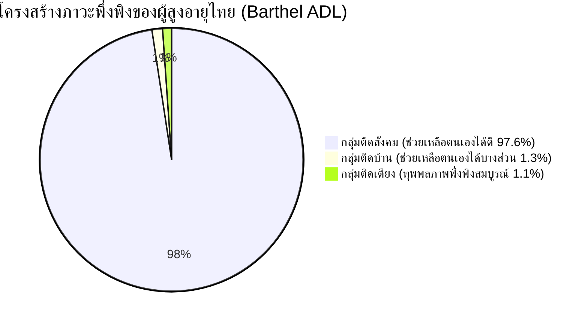

### 5.2 โครงสร้างพื้นฐานดิจิทัลสุขภาพไทยในปัจจุบัน (Current Digital Health Assets)
ประเทศไทยมีรากฐานระบบสาธารณสุขและเทคโนโลยีสารสนเทศที่มีศักยภาพสูง ได้แก่:
* **คลังข้อมูลสุขภาพกระทรวงสาธารณสุข (Health Data Center: HDC):** รวบรวมข้อมูลมาตรฐาน 43 แฟ้มจากสถานพยาบาลของรัฐทุกแห่ง ครอบคลุมการคัดกรอง NCDs ข้อมูลการรับบริการ OPD/IPD
* **แพลตฟอร์ม "หมอพร้อม" (MorProm):** แอปพลิเคชันสุขภาพแห่งชาติที่มีผู้ใช้งานลงทะเบียนกว่า 30 ล้านคน มีศักยภาพในการเป็น Personal Health Record (PHR) และช่องทางสื่อสารสุขภาพ
* **นโยบาย "30 บาทรักษาทุกที่ ด้วยบัตรประชาชนใบเดียว":** การปฏิรูประบบบริการสุขภาพให้ประชาชนเข้าถึงการรักษาในหน่วยบริการปฐมภูมิและเอกชนที่เข้าร่วมโครงการ
* **ระบบข้อมูลคัดกรองสุขภาพผู้สูงอายุ 9 ด้าน (Blue Book Online / DMS Care Tools):** เครื่องมือประเมินสุขภาพผู้สูงอายุเชิงรุกของกรมอนามัยและกรมการแพทย์

### 5.3 ทรัพย์สินเชิงยุทธศาสตร์: ทุนมนุษย์ อสม. 1.05 ล้านคน และระบบปฐมภูมิ รพ.สต.
ประเทศไทยมี **"อาวุธลับเชิงยุทธศาสตร์" ที่ไม่มีประเทศใดในโลกเลียนแบบได้ง่าย**:
* **เครือข่าย อสม. กว่า 1,050,000 คนทั่วประเทศ:** อาสาสมัครที่ฝังตัวลึกในทุกหมู่บ้าน รู้จักบริบทครอบครัว สภาพความเป็นอยู่ และเข้าถึงบ้านผู้สูงอายุได้ทุกหลังคาเรือน
* **โรงพยาบาลส่งเสริมสุขภาพตำบล (รพ.สต.) กว่า 9,800 แห่ง:** หน่วยบริการสาธารณสุขระดับรากหญ้าที่ใกล้ชิดประชาชนที่สุด
* **กลไก Care Manager (CM) และ Caregiver (CG):** ภายใต้การสนับสนุนงบประมาณของกองทุนการดูแลระยะยาว (LTC) ของ สปสช. ร่วมกับองค์กรปกครองส่วนท้องถิ่น (อปท.)

### 5.4 ช่องว่างเชิงโครงสร้างและจุดคอขวดวิกฤต (System Bottlenecks)
แม้จะมีโครงสร้างพื้นฐานที่ดี แต่ระบบสารสนเทศสุขภาพผู้สูงอายุของไทยยังติดหล่มปัญหาสำคัญ 5 ประการ:

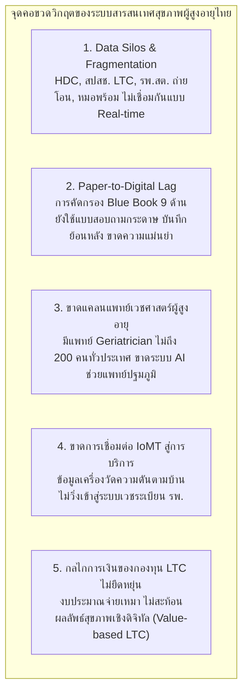

---

## ส่วนที่ 6: 5 เสาหลักเทคโนโลยีสารสนเทศสุขภาพผู้สูงอายุที่ควรผลักดันในประเทศไทย (Strategic Push for Thailand)

จากการสังเคราะห์บริบทของไทย ทิศทางการวิจัยระดับโลก และบทเรียนจากเอเชีย จึงขอเสนอ **5 เสาหลักเทคโนโลยีสารสนเทศสุขภาพผู้สูงอายุที่รัฐบาล กระทรวงสาธารณสุข และ สปสช. ควรจัดลำดับความสำคัญในการผลักดันอย่างเร่งด่วน**:

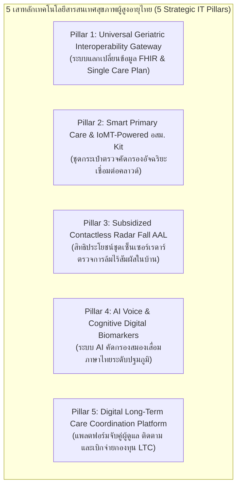

### 7.1 Pillar 1: Universal Geriatric Interoperability Gateway & FHIR Unified Care Plan
* **ปัญหาเดิม:** ข้อมูลการคัดกรอง 9 ด้านของกรมอนามัย อยู่คนละที่กับประวัติการรักษาในโรงพยาบาลของ สปส. และข้อมูลการเบิกจ่ายกองทุน LTC ของ สปสช. เมื่อผู้สูงอายุย้ายไปรักษาต่างโรงพยาบาล ข้อมูลแผนการดูแลไม่ต่อเนื่อง
* **สิ่งที่ต้องผลักดัน:**
  1. พัฒนา **National Geriatric Data Gateway** บนมาตรฐาน **HL7 FHIR v4/v5**
  2. สร้าง **"Single Digital Geriatric Care Plan"**: แผนการดูแลระยะยาวดิจิทัลฉบับเดียว ที่แพทย์ในโรงพยาบาล, พยาบาล รพ.สต., ผู้จัดการการดูแล (CM), ผู้ดูแล (CG), และ อสม. สามารถเข้าดูและอัปเดตสถานะร่วมกันได้แบบเรียลไทม์
  3. บูรณาการเข้ากับระบบ "หมอพร้อม" และ "30 บาทรักษาทุกที่" เพื่อให้บุตรหลานสามารถติดตามแผนการดูแลและนัดหมายบริการผ่านสมาร์ทโฟน

### 7.2 Pillar 2: Smart Primary Care & IoMT-Powered อสม. Mobile Screening Kits
* **ปัญหาเดิม:** อสม. เดินถือกระดาษคัดกรองสุขภาพผู้สูงอายุ การประเมินมวลกล้ามเนื้อและภาวะสมองเสื่อมใช้ความรู้สึกส่วนตัว ข้อมูลตกหล่นและคีย์เข้าระบบล่าช้าหลายเดือน
* **สิ่งที่ต้องผลักดัน:**
  1. พัฒนาชุดกระเป๋า **"Smart อสม. Tele-Kit"** ประกอบด้วย:
     - เครื่องวัดความดันโลหิตเชื่อมต่อ Bluetooth
     - เครื่องวัดน้ำตาลปลายนิ้วแบบซิงค์อัตโนมัติ
     - เครื่องวัดแรงบีบมือดิจิทัล (Digital Handgrip Dynamometer) เพื่อคัดกรอง Sarcopenia ตามเกณฑ์ AWGS
     - แท็บเล็ตที่ติดตั้งแอปพลิเคชันคัดกรองสุขภาพ 9 ด้าน (Blue Book Engine) ที่คำนวณคะแนนความเสี่ยงทันที
  2. เมื่อ อสม. ตรวจเสร็จ ข้อมูลจะซิงค์ผ่านระบบคลาวด์เข้าสู่ระบบ รพ.สต. และแจ้งเตือนพยาบาลวิชาชีพทันทีหากพบสัญญาณอันตราย (Red Flag)

### 7.3 Pillar 3: สิทธิประโยชน์อุปกรณ์เซ็นเซอร์เรดาร์เฝ้าระวังการล้มในบ้าน (Subsidized Radar AAL)
* **ปัญหาเดิม:** ผู้สูงอายุไทยหกล้มปีละกว่า 3 ล้านคน นำไปสู่กระดูกสะโพกหัก เลือดออกในสมอง และกลายเป็นผู้ป่วยติดเตียง โดยผู้สูงอายุส่วนใหญ่อยู่บ้านลำพังในเวลากลางวัน หรือล้มในห้องน้ำตอนกลางคืนโดยไม่มีใครรู้
* **สิ่งที่ต้องผลักดัน:**
  1. กรมการแพทย์ ร่วมกับ สปสช. และกองทุนฟื้นฟูสมรรถภาพระดับจังหวัด บรรจุ **"ชุดอุปกรณ์เรดาร์ตรวจจับการล้มแบบไร้สัมผัส (mmWave Radar Fall Detection)"** เข้าเป็นชุดสิทธิประโยชน์อุปกรณ์การแพทย์ (Medical Assistive Devices) สำหรับผู้สูงอายุกลุ่มเสี่ยงสูง (เช่น มีประวัติเคยล้ม, ได้คะแนน TUG > 12 วินาที, ผู้สูงอายุติดบ้านที่อยู่ลำพัง)
  2. เมื่อเรดาร์ตรวจพบการล้ม ระบบจะส่งสัญญาณเตือน SOS ผ่านเครือข่ายซิมเซลลูลาร์ (NB-IoT/4G) ไปยังสมาร์ทโฟนของบุตรหลาน, ศูนย์สั่งการกู้ชีพ 1669, และ อสม. ในพื้นที่ใกล้เคียงทันทีภายใน 10 วินาที

### 7.4 Pillar 4: AI Voice & Cognitive Digital Biomarkers คัดกรองสมองเสื่อมภาษาไทย
* **ปัญหาเดิม:** การคัดกรองสมองเสื่อมใน รพ.สต. ใช้แบบทดสอบกระดาษ (AMT หรือ MMSE-Thai) ซึ่งใช้เวลานาน มีอคติจากระดับการศึกษาของผู้สูงอายุ และมักตรวจพบเมื่อผู้ป่วยเข้าสู่ระยะสมองเสื่อมปานกลางถึงรุนแรงแล้ว
* **สิ่งที่ต้องผลักดัน:**
  1. การวิจัยและพัฒนา **Thai Geriatric Vocal Biomarker Model:** ร่วมมือระหว่างมหาวิทยาลัยแพทยศาสตร์ชั้นนำและ NECTEC ในการฝึกฝนโมเดล AI สำหรับวิเคราะห์เสียงพูดภาษาไทยและสำเนียงท้องถิ่น (อีสาน, เหนือ, ใต้)
  2. ออกแบบการทดสอบสั้น 2–3 นาทีผ่านสมาร์ทโฟน (เช่น ให้เล่าเรื่องภาพ ให้ทวนคำศัพท์ หรือให้อธิบายกิจวัตรประจำวัน) AI จะวิเคราะห์คุณลักษณะเสียง (Acoustic Features) และโครงสร้างภาษา เพื่อตัดเกรดความเสี่ยง Mild Cognitive Impairment (MCI) ช่วยให้ส่งต่อแพทย์เฉพาะทางเพื่อรับยาชะลอสมองเสื่อมได้ตั้งแต่ระยะเริ่มแรก

### 7.5 Pillar 5: Digital Long-Term Care Coordination & Caregiver Matching Ecosystem Platform
* **ปัญหาเดิม:** ประเทศไทยขาดแคลนผู้ดูแลมืออาชีพ ครอบครัวไม่รู้จะหาผู้ดูแลที่เชื่อถือได้จากที่ไหน ขณะที่ผู้ผ่านการอบรม Caregiver ของกรมอนามัย/สบส. ว่างงานหรือได้รับค่าตอบแทนต่ำ และการเบิกจ่ายงบประมาณกองทุน LTC ของท้องถิ่นมีความล่าช้าทางธุรการ
* **สิ่งที่ต้องผลักดัน:**
  1. สร้าง **"National LTC Caregiver Exchange Platform":** แพลตฟอร์มกลางที่เชื่อมโยง:
     - ทะเบียนผู้ดูแล (Caregiver Registry) ที่ผ่านการรับรองมาตรฐานจากกรม สบส.
     - ระบบจับคู่ความต้องการการดูแล (Smart Matching) ระหว่างผู้สูงอายุในชุมชนกับ Caregiver ในพื้นที่
     - ระบบบันทึกการปฏิบัติงานผ่านมือถือ (Proof of Care Delivery ด้วย GPS & Checklist)
  2. เชื่อมโยงระบบเบิกจ่ายค่าตอบแทนอัตโนมัติจากกองทุน LTC ของ สปสช. และ อปท. เข้าสู่บัญชีธนาคารของผู้ดูแลโดยตรงตามรอบผลงาน ลดภาระงานเอกสารของพยาบาล รพ.สต.

---

## ส่วนที่ 7: พิมพ์เขียวสถาปัตยกรรมระบบสารสนเทศสุขภาพผู้สูงอายุไทย (National Architecture Blueprint)

ภาพรวมสถาปัตยกรรมระบบสารสนเทศสุขภาพผู้สูงอายุแห่งชาติ (National Geriatric Digital Health Architecture):

```
+----------------------------------------------------------------------------------------------------+
|                                    USER & STAKEHOLDER TOUCHPOINTS                                   |
|   [ผู้สูงอายุ & ครอบครัว]          [อสม. ปฐมภูมิ]              [แพทย์/พยาบาล/CM]           [ผู้บริหาร สธ./สปสช.]  |
|      (หมอพร้อม / LINE OA)       (Smart อสม. App)        (Hospital HIS / Tele-Care)     (Executive Dashboard) |
+----------------------------------------------------------------------------------------------------+
                                                  │ (HTTPS / OAuth 2.0 / OpenID Connect)
                                                  ▼
+----------------------------------------------------------------------------------------------------+
|                                  API GATEWAY & INTEROPERABILITY LAYER                              |
|   • Authentication & RBAC (สอดคล้อง PDPA พ.ร.บ. คุ้มครองข้อมูลส่วนบุคคล)                                  |
|   • HL7 FHIR v4 API Gateway (Terminology Server: SNOMED CT, LOINC, ICD-10, TMT)                     |
|   • Event Streaming Hub (Kafka / MQTT สำหรับสัญญาณเตือนฉุกเฉินและข้อมูลเซ็นเซอร์ IoT)                  |
+----------------------------------------------------------------------------------------------------+
                                                  │
                 ┌────────────────────────────────┴────────────────────────────────┐
                 ▼                                                                 ▼
+--------------------------------------------------+             +-----------------------------------+
|             CORE BUSINESS SERVICES               |             |       INTELLIGENCE & AI ENGINE    |
| • Unified Digital Care Plan Engine               |             | • Fall Risk Predictive Model      |
| • Blue Book 9 Domains Scoring Service            |             | • Thai Vocal Biomarker Screener   |
| • Polypharmacy & Beers CDSS Alert                |             | • Sarcopenia / Gait CV Model      |
| • LTC Fund Automated Billing & Claims            |             | • Delirium Early Warning Score    |
| • Caregiver GPS Matching & Scheduling            |             | • Population Health Analytics     |
+--------------------------------------------------+             +-----------------------------------+
                 │                                                                 │
                 └────────────────────────────────┬────────────────────────────────┘
                                                  ▼
+----------------------------------------------------------------------------------------------------+
|                                      DATA PERSISTENCE & STORAGE                                    |
|   [FHIR Data Lake / Lakehouse]        [Relational / TimescaleDB]            [Secure Document Store]|
|   (Clinical Records, Care Plans)      (IoT Sensor Timeseries, Vitals)        (Lab Reports, Images)  |
+----------------------------------------------------------------------------------------------------+
                                                  │
                                                  ▼
+----------------------------------------------------------------------------------------------------+
|                                      EXTERNAL SYSTEM INTEGRATION                                   |
|   [MOPH Health Data Center (HDC)]     [NHSO Claim & LTC System]       [National EMS Dispatch 1669]  |
+----------------------------------------------------------------------------------------------------+
```

---

## ส่วนที่ 8: แผนงานขับเคลื่อนเชิงนโยบายและการลงทุน 5 ปี (5-Year Strategic Implementation Roadmap)

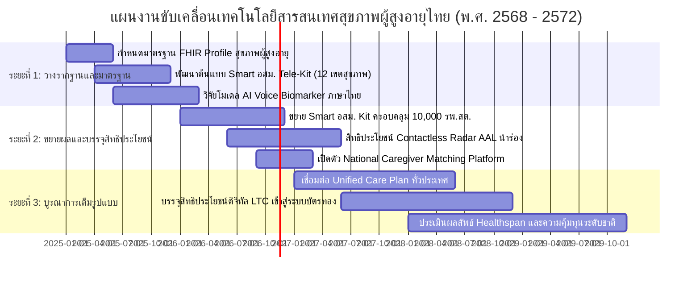

### การแบ่งระยะการขับเคลื่อนเชิงปฏิบัติการ (Actionable Phasing):

#### ระยะที่ 1: การวางมาตรฐานและพัฒนานำร่อง (ปีที่ 1–2: พ.ศ. 2568–2569)
1. **จัดทำ Thai Geriatric FHIR Implementation Guide (IG):** กระทรวงสาธารณสุขจับมือกับ สวรส. และสมาคมเวชศาสตร์ผู้สูงอายุไทย กำหนดโครงสร้างข้อมูลมาตรฐานสำหรับการคัดกรอง 9 ด้าน และแผนการดูแล LTC
2. **โครงการนำร่อง Smart อสม. Tele-Kit ใน 12 เขตสุขภาพ:** แจกจ่ายชุดตรวจวัดและแอปพลิเคชันคัดกรองให้ อสม. ดีเด่นใน 12 จังหวัดนำร่อง เพื่อทดสอบความเสถียรและความแม่นยำ
3. **การทดสอบ Regulatory Sandbox ด้าน AI และ AAL:** สํานักงานคณะกรรมการอาหารและยา (อย.) เปิดช่องทางพิเศษในการประเมินและรับรองซอฟต์แวร์การแพทย์ (SaMD) สำหรับ AI ตรวจคัดกรองสมองเสื่อมและเรดาร์ตรวจจับการล้ม

#### ระยะที่ 2: การขยายผลและการเชื่อมโยงสิทธิประโยชน์ (ปีที่ 3–4: พ.ศ. 2570–2571)
1. **บรรจุชุดเซ็นเซอร์ป้องกันการล้มในสิทธิประโยชน์ สปสช.:** ผู้สูงอายุกลุ่มเสี่ยงสูงที่ผ่านเกณฑ์การประเมินสามารถเบิกอุปกรณ์เซ็นเซอร์เรดาร์ไปติดตั้งที่บ้านได้โดยไม่มีค่าใช้จ่าย ผ่านกองทุนฟื้นฟูสมรรถภาพระดับจังหวัด
2. **ขยายผล Smart อสม. สู่ระดับประเทศ:** รพ.สต. ทุกแห่งมีชุดตรวจประจำทีมหมอคนที่ 1 (อสม.) และหมอคนที่ 2 (เจ้าหน้าที่สาธารณสุข)
3. **เปิดใช้งานระบบ Single Digital Care Plan:** บูรณาการระหว่างโรงพยาบาลศูนย์ โรงพยาบาลชุมชน และ อปท. ครอบคลุมผู้สูงอายุติดบ้าน-ติดเตียง 100%

#### ระยะที่ 3: สู่ระบบนิเวศการดูแลอัจฉริยะอย่างยั่งยืน (ปีที่ 5: พ.ศ. 2572 เป็นต้นไป)
1. **Value-Based LTC Financing:** ปรับเปลี่ยนการจัดสรรงบประมาณกองทุน LTC จากการจ่ายตามกิจกรรม (Fee-for-Service) มาเป็นการจ่ายตามผลลัพธ์สุขภาพ (เช่น สามารถคงสภาพหรือฟื้นฟูคะแนน ADL, ป้องกันการเกิดแผลกดทับ, ลดอัตราการนอนโรงพยาบาลซ้ำ)
2. **National Geriatric AI Command Center:** แดชบอร์ดปัญญาประดิษฐ์ระดับกระทรวงที่วิเคราะห์แนวโน้มสุขภาพ ความต้องการผู้ดูแล และจัดสรรทรัพยากรการแพทย์ล่วงหน้าอย่างแม่นยำ

---

## ส่วนที่ 9: บทสรุปและรายการเอกสารอ้างอิงทางวิชาการระดับสากล (References & Authoritative Sources)

### บทสรุปเชิงนโยบาย (Concluding Synthesis)
การรับมือกับสังคมสูงวัยขั้นสุดยอดของประเทศไทย ไม่สามารถใช้วิธีการแบบดั้งเดิมที่เน้นการสร้างโรงพยาบาลเพิ่มหรือการผลิตแพทย์เฉพาะทางเพียงอย่างเดียวได้อีกต่อไป เนื่องจากข้อจำกัดด้านงบประมาณและเวลา การนำ **"เทคโนโลยีสารสนเทศสุขภาพขั้นสูง" (Health Informatics)** มาผสานเข้ากับ **"ทุนทางสังคมและระบบปฐมภูมิที่เข้มแข็งของไทย" (เครือข่าย อสม. และ รพ.สต.)** คือหนทางเดียวที่จะเปลี่ยนวิกฤตความชราภาพให้เป็นพลังแห่งการพัฒนา โดยการ:
1. ป้องกันและชะลอการเปลี่ยนผ่านจาก **"กลุ่มติดสังคม" สู่ "กลุ่มติดบ้านและติดเตียง"** ให้นานที่สุด
2. ลดภาระของระบบการรักษาพยาบาลระดับตติยภูมิ และลดความเหลื่อมล้ำในการเข้าถึงบริการสุขภาพ
3. ยกระดับคุณภาพชีวิตของผู้สูงอายุไทยให้สามารถ **"แก่ตัวลงในบ้านและชุมชนของตนเองอย่างมีศักดิ์ศรีและปลอดภัย" (Ageing in Place with Dignity and Safety)**

---

### เอกสารอ้างอิงและแหล่งข้อมูลทางวิชาการระดับสากล (Authoritative References):

1. **World Health Organization (WHO):**
   - *Integrated Care for Older People (ICOPE): Guidance for Person-Centred Assessment and Pathways in Primary Care.* Geneva: World Health Organization; 2019.
   - *UN Decade of Healthy Ageing (2021–2030): Baseline Report.* Geneva: World Health Organization; 2020.
   - *WHO Commission on Social Connection (2024–2026): Scientific Advisory Framework on Loneliness and Health Outcomes.*
2. **Geroscience & Molecular Biology of Aging:**
   - López-Otín, C., Blasco, M. A., Partridge, L., Serrano, M., & Kroemer, G. (2023). *Hallmarks of aging: An expanding universe.* **Cell**, 186(2), 243–278.
   - Kirkland, J. L., & Tchkonia, T. (2020). *Senolytic drugs: from discovery to translation.* **Journal of Internal Medicine**, 288(5), 518–536.
   - Horvath, S., & Raj, K. (2018). *DNA methylation-based biomarkers and the epigenetic clock theory of ageing.* **Nature Reviews Genetics**, 19(6), 371–384.
3. **Dementia & Neurodegenerative Disease Clinical Trials:**
   - van Dyck, C. H., et al. (2023). *Lecanemab in Early Alzheimer’s Disease (Clarity AD).* **New England Journal of Medicine**, 388(1), 9–21.
   - Sims, J. R., et al. (2023). *Donanemab in Early Symptomatic Alzheimer Disease: The TRAILBLAZER-ALZ 2 Randomized Clinical Trial.* **JAMA**, 330(6), 512–527.
   - Ashton, N. J., et al. (2024). *Diagnostic Accuracy of a Plasma Phosphorylated Tau 217 Assay for Alzheimer Disease Pathology.* **JAMA Neurology**, 81(3), 255–263.
   - Livingston, G., et al. (2024). *Dementia prevention, intervention, and care: 2024 report of the Lancet standing Commission.* **The Lancet**, 404(10452), 572–626.
4. **Cardiometabolic & Musculoskeletal Clinical Evidence:**
   - Anker, S. D., et al. (2021). *Empagliflozin in Heart Failure with a Preserved Ejection Fraction (EMPEROR-Preserved).* **New England Journal of Medicine**, 385(16), 1451–1461.
   - Kosiborod, M. N., et al. (2023). *Semaglutide in Patients with Heart Failure with Preserved Ejection Fraction and Obesity (STEP-HFpEF).* **New England Journal of Medicine**, 389(12), 1069–1084.
   - Chen, L. K., et al. (2020). *Asian Working Group for Sarcopenia: 2019 Consensus Update on Sarcopenia Diagnosis and Treatment.* **Journal of the American Medical Directors Association (JAMDA)**, 21(3), 300–307.
   - 2023 American Geriatrics Society Beers Criteria Update Expert Panel. (2023). *American Geriatrics Society 2023 updated AGS Beers Criteria for potentially inappropriate medication use in older adults.* **Journal of the American Geriatrics Society**, 71(7), 2052–2081.
5. **Asian Health IT & Digital Health Frameworks:**
   - Ministry of Health, Labour and Welfare (MHLW), Japan. (2023). *Development and Promotion of Nursing Care Robots and Long-Term Care Database (Kaigo-DB) Strategic Plan.*
   - Synapxe Singapore & Ministry of Health (MOH). (2023). *Healthier SG Whitepaper & National Electronic Health Record (NEHR) Interoperability Specifications.*
   - National Information Society Agency (NIA), South Korea. (2023). *AI Care Robot Deployment and Smart Senior Living Innovation Report.*
   - National Health Insurance Administration (NHIA), Taiwan. (2023). *NHI MediCloud System and Smart Healthcare Ecosystem Whitepaper.*
6. **Thailand National Health Data & Policy:**
   - กระทรวงสาธารณสุข. (2566–2567). *รายงานสถิติสาธารณสุข (Public Health Statistics Thailand).* กองยุทธศาสตร์และแผนงาน สำนักงานปลัดกระทรวงสาธารณสุข.
   - คลังข้อมูลสุขภาพ Health Data Center (HDC). *ระบบสารสนเทศสนับสนุนการบริหารจัดการระบบสุขภาพ กลุ่มวัยผู้สูงอายุ.* กระทรวงสาธารณสุข.
   - สำนักอนามัยผู้สูงอายุ กรมอนามัย. (2566). *คู่มือการคัดกรองและประเมินสุขภาพผู้สูงอายุ 9 ด้าน (สมุดประเมินสุขภาพผู้สูงอายุ Blue Book).*
   - สำนักงานหลักประกันสุขภาพแห่งชาติ (สปสช.). *รายงานผลการดำเนินงานกองทุนหลักประกันสุขภาพระดับท้องถิ่นหรือพื้นที่ และการดูแลระยะยาวด้านสาธารณสุขสำหรับผู้สูงอายุที่มีภาวะพึ่งพิง (LTC).*
